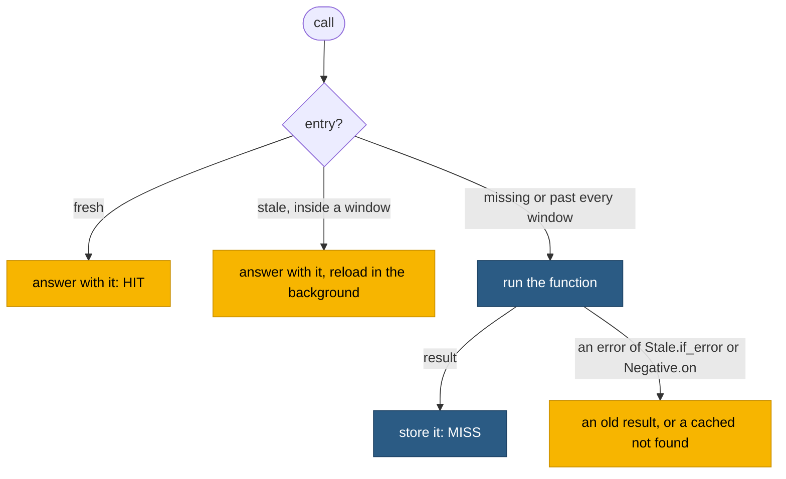

# Core concepts

How pashe works, in a few pages' worth; the [Glossary](glossary.md) names each thing in one word.

## How a cached call is answered

Every call of a cached function reads its entry and decides how to answer:

A result is **fresh** for its `ttl`. Past it the result is **stale**: the windows of `Stale`,
`while_revalidate`, `if_error` and `if_slow`, let it answer for a while longer, each in its own
case. Past every window the entry is gone, and the call loads.

How each call was answered goes to `on_call` of the hooks of the cache as a `CacheStatus`: `HIT`, `MISS`,
`STALE_WHILE_REVALIDATE`, `STALE_IF_ERROR`, `STALE_IF_SLOW`, `NOT_FOUND` or `FALLBACK`.

## Keys

The key of a call is a template over the arguments by name, such as `"user:{user_id}"`, or by
default the qualified name of the function and the `repr` of its arguments, under the `prefix`
of the cache. A part of a key must read the same in every process: `str`, `int`, `float`,
`bool`, `None`, `date`, `time`, `datetime`, `UUID`, `Decimal` or enums of those, or a digest of
any other value, such as `{filters:blake2b}`. [`key`](guides/caching/keys.md) shows how
each case is built.

## Types

A stored result decodes as the return annotation of the function. An entry also remembers the
shape of that type, its classes and fields: after a deploy that changes the type, old entries
are misses instead of decoding into the wrong form.

## Tags

`invalidate_tags("users")` makes every result stored with the tag `users` a miss, however many
there are: it costs two calls to the backend and scans no key. [What is in Redis](deep-dive/storage.md#the-keys-of-the-cache)
shows how.

## Where each feature works

A feature that lives in the backend works for every process over that backend; one that lives in
the cache works in its process only. So the backend decides how far a lock, a limit or a tag
reaches: over memory, a lock keeps apart the threads and tasks of one process, not two machines.

[What to choose](guides/choosing.md#where-each-feature-works) lists where every feature lives.

| In the memory of each process | In Redis, shared by every process |
| --- | --- |
| `Stampede(share_loads=..., max_loads=...)`, the copies of a near cache, the fallback | the entries, the tag counters, the locks of `Stampede(lock_for=...)`, locks, the counters of rate limits |

In the diagrams of these docs a box is where something lives: blue and green boxes are
processes, each with its own memory; the yellow box is Redis, shared by every process.

## Sync and async

`Cache` is for `def` code over a sync backend, `AsyncCache` for `async def` code over an async
one: the same classes and methods, the async ones awaited. A function of the other side is
refused when it is decorated. Both behave the same.
