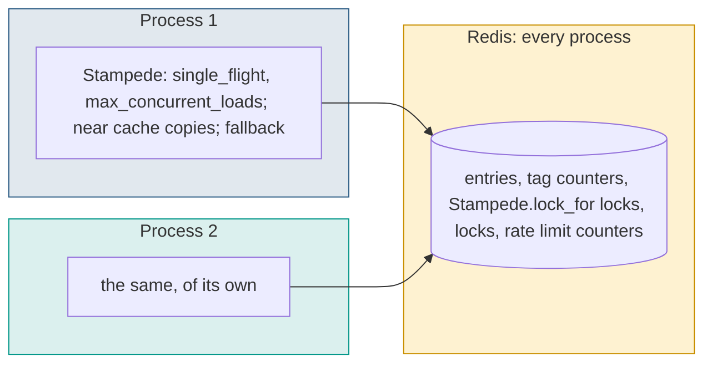

# Core concepts

## How a cached call is answered

Every call of a cached function reads its entry and decides how to answer:

A result is **fresh** for its `ttl`. Past it the result is **stale**: the windows of `Stale`,
`while_revalidate`, `if_error` and `if_slow`, let it answer for a while longer, each in its own
case. Past every window the entry is gone, and the call loads.

How each call was answered goes to `on_call` of the hooks of the cache as a `CacheStatus`: `HIT`, `MISS`,
`STALE_WHILE_REVALIDATE`, `STALE_IF_ERROR`, `STALE_IF_SLOW`, `NOT_FOUND` or `FALLBACK`.

## Keys

The key of a call is a template over the arguments by name, such as `"user:{user_id}"`, or by
default the qualified name of the function and the `repr` of its arguments, under the `prefix`
of the cache. A part of a key must read the same in every process: `str`, `int`, `float`,
`bool`, `None`, `date`, `time`, `datetime`, `UUID`, `Decimal` or enums of those, or a digest of
any other value, such as `{filters:blake2b}`. [`key`](guides/caching/keys.md) shows how
each case is built.

## Types

A stored result decodes as the return annotation of the function. An entry also remembers the
shape of that type, its classes and fields: after a deploy that changes the type, old entries
are misses instead of decoding into the wrong form.

## Tags

A tag has a generation counter, and an entry remembers the generations of its tags. Invalidating
a tag bumps its counter, two calls to the backend however many entries it covers, and every entry
stored with the old generation becomes a miss. Nothing is scanned.

| | `__tag:users` | `user:1`, stored with `users` | `get_user(1)` |
| --- | --- | --- | --- |
| stored | `4711` | remembers `users: 4711` | HIT |
| `invalidate_tags("users")` | `4712` | still remembers `4711` | MISS: loads, stores with `4712` |

## Processes

EntryCodec, tags, locks and rate limits live in the backend, so every process that uses the same
Redis shares them. Sharing loads between concurrent calls happens in two places: `Stampede.single_flight`
inside a process, `Stampede.lock_for` across processes.

In the diagrams of these docs a box is where something lives: blue and green boxes are
processes, each with its own memory; the yellow box is Redis, shared by every process.

## Sync and async

`Cache` is for `def` code over a sync backend, `AsyncCache` for `async def` code over an async
one: the same classes and methods, the async ones awaited. A function of the other side is
refused when it is decorated. The sync side is generated from the async one, so both behave
the same.
