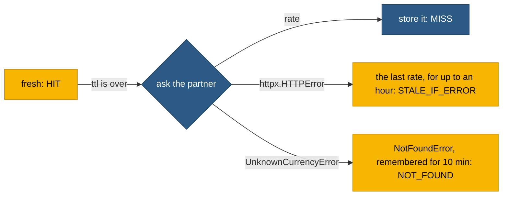
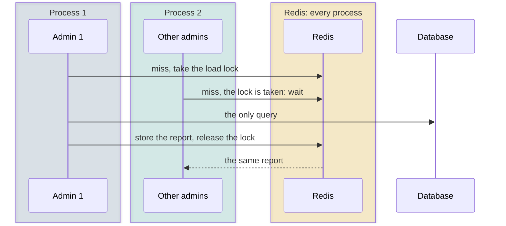
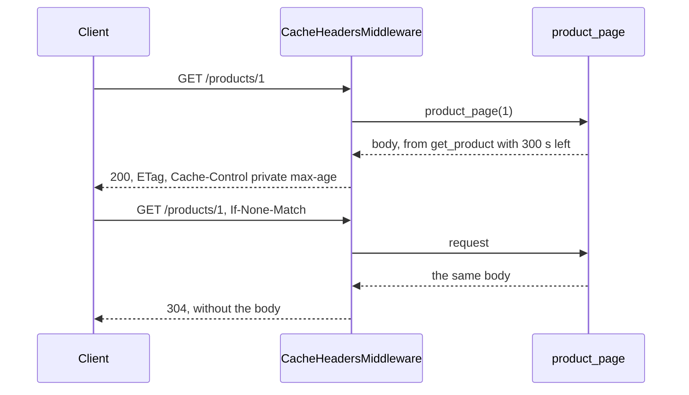
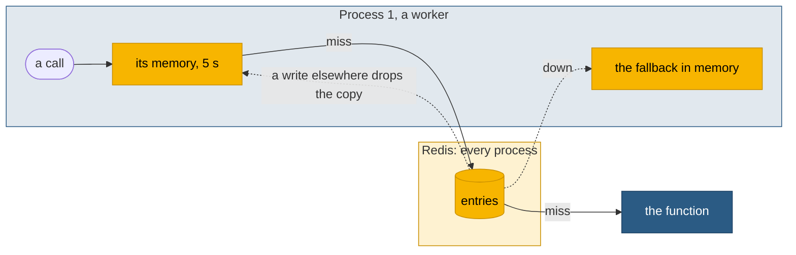

# Examples

This page builds an online shop, from its first cached query to a service of many processes.
The examples build on each other, like the modules of one application. Pick **Sync** or **Async**
once, and every example on every page switches with it.

The diagram above each example shows what it does. Yellow means the answer comes from the
cache, blue means the call reaches the source, and a box is a process or Redis, as
[Core concepts](concepts.md#where-each-feature-works) explains.

## The shop

`db` is the connection to the database of the shop: `sqlite3` on the sync side, `aiosqlite` on
the async one. `partner` and `payments` are `httpx` clients of the APIs the shop calls.

=== "Sync"

    ```python
    --8<-- "shop/shop_sync.py"
    ```

=== "Async"

    ```python
    --8<-- "shop/shop_async.py"
    ```

`MsgspecJsonCodec` rebuilds a `Product` from the cached function's return annotation. The
default `JsonCodec` would give you back a `dict`.

## 1. A slow query

Your product page reads its product from the database on every request. Cache it for five
minutes:

=== "Sync"

    ```python
    --8<-- "shop/slow_query_sync.py:show"
    --8<-- "shop/slow_query_sync.py:calls"
    ```

=== "Async"

    ```python
    --8<-- "shop/slow_query_async.py:show"
    --8<-- "shop/slow_query_async.py:calls"
    ```

```text title="Queries to the database"
get_product(1)  1 query
get_product(1)  0 queries
```

## 2. Data that changes

A new price has to show up at once, on the product page and on every list of its category. Tag
what depends on what, and tell the cache when you write. `change_price` stores the new price with
`get_product.set` and drops every list tagged `category:coffee`. The next `list_category` call
reloads it.

=== "Sync"

    ```python
    --8<-- "shop/data_changes_sync.py:imports"
    --8<-- "shop/data_changes_sync.py:show"
    --8<-- "shop/data_changes_sync.py:calls"
    ```

=== "Async"

    ```python
    --8<-- "shop/data_changes_async.py:imports"
    --8<-- "shop/data_changes_async.py:show"
    --8<-- "shop/data_changes_async.py:calls"
    ```

`set` stores the new product without a query. The tag drops every list of the category in one
write, no matter how many there are.

## 3. A partner that fails

Prices show in the customer's currency, and the rates come from a partner API that's down now
and then. A rate that's an hour old beats an error page. And when the partner doesn't know a
currency, you don't want to ask again on every request:



=== "Sync"

    ```python
    --8<-- "shop/partner_sync.py:imports"
    --8<-- "shop/partner_sync.py:show"
    --8<-- "shop/partner_sync.py:calls"
    ```

=== "Async"

    ```python
    --8<-- "shop/partner_async.py:imports"
    --8<-- "shop/partner_async.py:show"
    --8<-- "shop/partner_async.py:calls"
    ```

A call for an unknown currency raises `NotFoundError`. For the next ten minutes, that answer
comes from the cache.

## 4. An expensive report under load

A day's sales report takes seconds to build. When it expires, every admin who opens the
dashboard at that moment would start building a new one:



=== "Sync"

    ```python
    --8<-- "shop/report_sync.py:imports"
    --8<-- "shop/report_sync.py:show"
    --8<-- "shop/report_sync.py:calls"
    ```

=== "Async"

    ```python
    --8<-- "shop/report_async.py:imports"
    --8<-- "shop/report_async.py:show"
    --8<-- "shop/report_async.py:calls"
    ```

## 5. A feed of many products

The home page shows fifty prices. Fifty cached calls mean fifty round trips to the cache. A
batch function reads them all in one and queries only the missing ones:

=== "Sync"

    ```python
    --8<-- "shop/feed_sync.py:show"
    --8<-- "shop/feed_sync.py:calls"
    ```

=== "Async"

    ```python
    --8<-- "shop/feed_async.py:show"
    --8<-- "shop/feed_async.py:calls"
    ```

```text title="Queries to the database"
get_prices([1, 2])     1 query
get_prices([1, 2, 3])  1 query
```

## 6. A token that says how long it lives

The payment provider hands out access tokens and tells you how long each one is valid. Keep
each token that long, minus a minute of margin:

<div class="pashe-timeline">
<div class="pashe-timeline__fresh" style="flex: 3540" data-start="0"><b>HIT</b><br>the same token for every call</div>
<div class="pashe-timeline__source" style="flex: 60" data-start="59 min"><b>MISS</b><br>a new token, the old one still valid</div>
<div class="pashe-timeline__stale" data-start="60 min"><b>the old token</b><br>expires, used by no call</div>
</div>

=== "Sync"

    ```python
    --8<-- "shop/token_sync.py:imports"
    --8<-- "shop/token_sync.py:show"
    --8<-- "shop/token_sync.py:calls"
    ```

=== "Async"

    ```python
    --8<-- "shop/token_async.py:imports"
    --8<-- "shop/token_async.py:show"
    --8<-- "shop/token_async.py:calls"
    ```

## 7. Logins, quotas and a nightly job

The limits and locks live in the backend, so every process of the shop shares them. Five failed
logins for an email in 15 minutes ban it for an hour. A partner gets 100 searches a minute. The
nightly export runs on one server while the others skip it.

=== "Sync"

    ```python
    --8<-- "shop/limits_sync.py:imports"
    --8<-- "shop/limits_sync.py:show"
    --8<-- "shop/limits_sync.py:calls"
    ```

=== "Async"

    ```python
    --8<-- "shop/limits_async.py:imports"
    --8<-- "shop/limits_async.py:show"
    --8<-- "shop/limits_async.py:calls"
    ```

## 8. A web service

Here's the product page over HTTP, with caching headers and a quota for each client:



=== "Sync"

    ```python hl_lines="6 11 24"
    --8<-- "shop/web_sync.py:imports"
    --8<-- "shop/web_sync.py:show"
    ```

=== "Async"

    ```python hl_lines="6 11 24"
    --8<-- "shop/web_async.py:imports"
    --8<-- "shop/web_async.py:show"
    ```

Send a second request with the first one's `ETag` in `If-None-Match`, and you get `304`, with no
body:

```console title="Two requests to the service" hl_lines="5 6 7 11"
$ curl -i http://localhost:8000/products/1
HTTP/1.1 200 OK
content-length: 68
content-type: application/json
etag: "558ab5fd04ed91e5448d53a2115d8dfb"
cache-control: private, max-age=299
cache-status: pashe; hit; ttl=299

{"id":1,"name":"Coffee beans","category":"coffee","price_cents":990}
$ curl -i http://localhost:8000/products/1 -H 'If-None-Match: "558ab5fd04ed91e5448d53a2115d8dfb"'
HTTP/1.1 304 Not Modified
etag: "558ab5fd04ed91e5448d53a2115d8dfb"
cache-control: private, max-age=299
cache-status: pashe; hit; ttl=299
```

## 9. Many processes in production

Every worker on every server shares Redis. Each keeps hot entries in its own memory for five
seconds, and it answers from a fallback while Redis is down:



=== "Sync"

    ```python
    --8<-- "shop/production_sync.py"
    ```

=== "Async"

    ```python
    --8<-- "shop/production_async.py"
    ```
