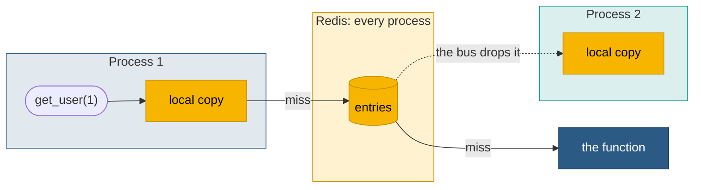
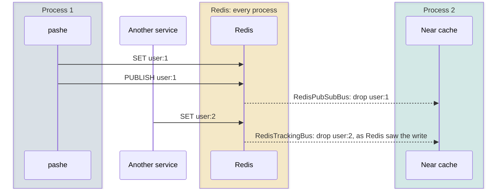

# Near cache

`NearCacheBackend`, a near cache, keeps copies of hot keys in the memory of each process, in front of a shared
backend such as Redis. A read of a copy does not leave the process: hot keys do not load one
Redis node, and reads go on for a while when Redis is slow.



=== "Sync"

    ```python
    --8<-- "backends/near_cache_sync.py:show"
    ```

=== "Async"

    ```python
    --8<-- "backends/near_cache_async.py:show"
    ```

## How it reads and writes

1. A read looks in the local memory first. A copy answers at once.
2. A key without a copy is read from the shared backend, and the value is copied to local memory
   for `local_ttl` seconds, 5 by default. `MemoryBackend(max_entries=...)` bounds the copies.
3. A write goes to the shared backend and drops the local copy of the key, so this process reads
   the new value next.
4. Other processes still hold their copies. Without a bus each answers with its copy for up to
   `local_ttl`: that is how stale a near cache may be. A bus tells them at once.

A copy is made only if no drop of the key came while it was read, so a value read just before a
change does not outlive the change.

`hooks=` takes the hooks of the cache, such as the metrics of `pashe.contrib.opentelemetry`: a
near cache tells them how many keys its copies answered, with `on_near_read`, and when it dropped
every copy, with `on_near_flush`. See [Metrics and logs](../observability/hooks.md).

## Telling the other processes

A bus carries "these keys changed" between the near caches of every process; only the names of
keys travel, never values. A near cache starts listening to its bus on its first read, and a
process that hears of a key drops its copy: its next read goes to the shared backend.

| Bus | How it learns of a change | Sees writes of | Needs |
| --- | --- | --- | --- |
| `RedisPubSubBus` | the writer publishes the keys it changed on a channel | pashe only | any Redis, Valkey, a Redis Cluster |
| `RedisTrackingBus` | Redis tells, with `CLIENT TRACKING` in broadcasting mode | anyone: pashe, other services, `redis-cli` | Redis or Valkey 6 or later, one node |



### `RedisPubSubBus`

The near cache that writes publishes the changed keys on a channel, `pashe:near-cache` by
default; every process subscribed to it drops its copies. Give every process of one cache the
same channel, and two caches that must not hear each other different ones. Writes made past
pashe, by another service or by hand, are not published: those copies live out `local_ttl`.

Every near cache hears every message, its own too: the one that wrote drops its copy of the key,
and its next read of it goes to the shared backend once. Near caches may share a bus and its
client.

### `RedisTrackingBus`

Redis itself tells about every write under a prefix, whoever made it, so pashe publishes
nothing. Give it the prefix of the cache, such as `prefix="app:"`: without one every process
hears of every write to the whole Redis. Tracking in broadcasting mode costs the server no
memory. The bus listens on a connection of its own; on a Redis Cluster a node tracks only its
own keys, so take `RedisPubSubBus` there.

### When messages are lost

A message sent while a process is disconnected never reaches it. So whenever a bus cannot be
sure it heard everything, the near cache drops all its copies: when it subscribes, as a copy may
be older than the subscription, and after every error of the connection. It listens again after a second, and waits twice as long
each time Redis fails again, up to 30 seconds, so the processes of a service do not all reconnect
at once. A failed publish is not raised, as the write itself succeeded: the next publish that
goes through tells the other processes to drop every copy, and until then they drop theirs
within `local_ttl` at the latest.

!!! note

    `RedisTrackingBus` needs Redis or Valkey 6 or later; a clone of Redis without
    `CLIENT TRACKING`, such as some versions of Dragonfly, takes `RedisPubSubBus`.

### Writing your own bus

Subclass `InvalidationBus`, or `AsyncInvalidationBus`, from `pashe.invalidation`, for another
transport such as NATS or Kafka. `publish(keys)` tells the other processes that keys changed;
`None` means every key. `listen(on_invalidate)` calls `on_invalidate` with the keys others publish, until
the function it returns is called.

---

API reference: [`pashe.backends`](../../reference/backends.md), [`pashe.invalidation`](../../reference/invalidation.md), [`pashe.contrib.redis`](../../reference/contrib/redis.md).
