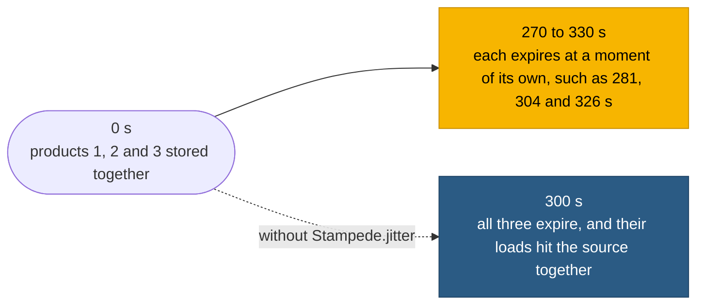

# Caching a function

`@cache(...)` caches the results of a function of the side of the cache: the first call of
the arguments runs it and stores the result, the next ones are answered from the backend until its
TTL ends.

=== "Sync"

    ```python
    --8<-- "caching_functions/decorator_sync.py:show"
    ```

    1. Fresh for 5 minutes: seconds, a `timedelta`, or a function of the result.
    2. The key of a call: `user:1` for `get_user(1)`, under the `prefix` of the cache.
    3. `cache.invalidate_tags("users")` drops every result stored with this tag, without a scan.
    4. TTLs spread by +-10%, so entries stored together do not expire together.
    5. The return annotation says what the stored value decodes as.

=== "Async"

    ```python
    --8<-- "caching_functions/decorator_async.py:show"
    ```

    1. Fresh for 5 minutes: seconds, a `timedelta`, or a function of the result.
    2. The key of a call: `user:1` for `get_user(1)`, under the `prefix` of the cache.
    3. `cache.invalidate_tags("users")` drops every result stored with this tag, without a scan.
    4. TTLs spread by +-10%, so entries stored together do not expire together.
    5. The return annotation says what the stored value decodes as.

| Option | Type | Default | What it does |
| --- | --- | --- | --- |
| `ttl` | `float | int | timedelta | Callable[[R], float | int | timedelta]` | required | how long a result is fresh: seconds, a `timedelta`, or a function of the result |
| `key` | `str | None` | the name of the function and the `repr` of its arguments | a `str.format` template over the arguments by name |
| `tags` | `list[str] | tuple[str, ...]` | `()` | templates like `key`; `invalidate_tags` of any of them makes the result a miss |
| `stale` | `Stale` | `Stale()` | how long after the TTL a stale result still answers: [Stale results and failures](../failures/stale.md) |
| `stampede` | `Stampede` | `Stampede()` | how loads are shared and spread, `jitter` too: [`Stampede`](../failures/stampedes.md) |
| `negative` | `Negative` | `Negative()` | loader errors kept as the answer "no such data": [`Negative`](what-is-stored.md#negative-caching) |
| `store` | `Store` | `Store()` | which results are stored: [below](what-is-stored.md#storing-only-some-results) |

`R` in the type of `ttl` is the type the function returns. The groups are in `pashe.options`, and the [options reference](../../reference/options.md) lists
every field of each.

`Stampede(jitter=...)` keeps entries stored together from expiring together:



The options of [stale results](../failures/stale.md) and of [stampedes](../failures/stampedes.md) have their own
pages.

## Every option

=== "Sync"

    ```python
    --8<-- "caching_functions/decorator_options_sync.py:show"
    ```

=== "Async"

    ```python
    --8<-- "caching_functions/decorator_options_async.py:show"
    ```

## Reading and writing a result

=== "Sync"

    ```python
    --8<-- "caching_functions/methods_sync.py:show"
    ```

=== "Async"

    ```python
    --8<-- "caching_functions/methods_async.py:show"
    ```

`get`, `set`, `refresh` and `invalidate` take the same arguments as the function, so they find the same entry.

!!! warning "Cached methods share one entry across instances"

    A method can be cached too. `self` and `cls` are left out of the default key, so every
    instance shares one entry per arguments; when the result depends on the instance, name it in
    the template, such as `key="user:{self.id}"`.

---

API reference: [`pashe`](../../reference/caches.md), [options](../../reference/options.md).
