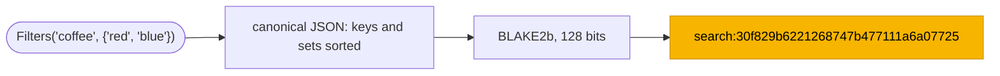

# Keys

The key of a call is the `prefix` of the cache followed by the key of the function: its default
key, or the template of `key=` filled with the arguments. The keys below are of a cache with
`prefix="shop:"`, and of functions in the file `app/users.py`: the module `app.users`.

## The default key

Without `key=`, the key is the module and the qualified name of the function, then the `repr`
of every argument, joined by `:`. Each call shows its key:

```{.python title="app/users.py"}
--8<-- "caching_functions/default_key.py:show"
```

- Arguments are bound to the signature first, so a positional and a keyword call share a key,
  and a default value is in the key as if it was passed.
- A string is quoted by its `repr`: `get_page(1, "2")` and `get_page(1, 2)` do not share a key.
- `self` and `cls` of a method are left out: every instance shares an entry per arguments.
- An argument must be `str`, `int`, `float`, `bool`, `None`, `date`, `time`, `datetime`, `UUID`,
  `Decimal` or an enum of those. Any other raises `TypeError` when the function is called:
  `argument 'filters' is a dict: pass key= with a template to name it, or to hash it, such as
  "{filters:blake2b}"`.

!!! note "Renaming a function changes its keys"

    The default key holds the name and the module of the function. After a deploy that renames
    or moves it, its old entries are misses and expire with their TTL. Give a template, such as
    `key="user:{user_id}"`, when the key must outlive a rename, or when another service, a tag
    or `redis-cli` uses it. A template is shorter in the backend too.

## A template

`key=` is a `str.format` template over the arguments by name. A field can reach into an
argument and take a format spec:

```{.python title="app/users.py"}
--8<-- "caching_functions/template_key.py:show"
```

A field puts the text of the value, as `str.format` does: no quotes, so `{lang}` is `ru`. It
takes only values whose text is the same in every process: `str`, `int`, `float`, `bool`,
`None`, `date`, `time`, `datetime`, `UUID`, `Decimal` and enums of those. Any other value raises
`TypeError` when the function is called: the text of an object may be its address, and the
order of a set differs between processes, so each call or each process would store an entry of
its own. Name a plain part of the value, such as `{user.id}`, or [hash it](#digests-and-cachekey_for).

!!! warning "A template names everything the result depends on"

    With `key="orders"` on `get_orders(user_id)` every user shares one entry, and the second
    user gets the orders of the first. A key holds what the template names and nothing else.

A template puts a value in the key as it is: with `key="doc:{owner}:{name}"` the calls
`("a:b", "c")` and `("a", "b:c")` share one entry. Hash a part that comes from users and may
hold the separator, such as `{name:blake2b}`, so each call gets a key of its own.

A template is checked when the function is decorated: a field that is not a parameter of the
function, such as `{usr_id}` for `user_id`, an unknown digest such as `{query:hsah}`, or `hmac`
on a cache without `key_secret`, raises `InvalidOptionsError` at once.

## Digests and `cache.key_for`

A field can be a digest of the argument instead of the argument itself:

| Template | Puts in the key | For |
| --- | --- | --- |
| `{query:blake2b}` | 128 bits of BLAKE2b | an argument too long for a key, or with no plain form, such as a dict of filters |
| `{query:sha256}` | 128 bits of SHA-256 | the same, where only FIPS algorithms are allowed |
| `{email:hmac}` | 128 bits of HMAC-SHA256 under `key_secret` | data that must not be readable in the backend |

Take `blake2b` by default; `sha256` where a policy allows only FIPS algorithms; `hmac` for
personal data.

A digest is of the value as canonical JSON, so equal values give one key in every process:



=== "Sync"

    ```python
    --8<-- "caching_functions/digests_sync.py:show"
    --8<-- "caching_functions/digests_sync.py:calls"
    ```

=== "Async"

    ```python
    --8<-- "caching_functions/digests_async.py:show"
    --8<-- "caching_functions/digests_async.py:calls"
    ```

```{.python title="app/users.py"}
--8<-- "caching_functions/digest_keys.py:show"
```

The second call passes the set in another order and gets the same key: a set is sorted before
the digest.

Canonical JSON holds:

- `str`, `int`, `float`, `bool`, `None`, lists and tuples as JSON does;
- a dict with its keys sorted, and a set or a frozenset with its items sorted;
- a dataclass as the dict of its fields;
- an enum as its value, `date`, `time` and `datetime` as ISO 8601, `UUID` and `Decimal` as text.

Any other value, and a dataclass whose fields point back to it, raises `TypeError`: `cannot
hash a User into a key`. Other parts of the template stay readable, and `invalidate` and `set`
find the entry as calls do.

!!! warning "An ORM object does not go in a key"

    A model of SQLAlchemy or of another ORM has no plain form: its relationships are queries to
    the database, and may point back to it. Put its id in the key, `key="orders:{user.id}"`, or
    better pass the cached function the id itself, `get_orders(user_id: int)`.

!!! warning "A plain digest does not hide data"

    A digest of an email is found again by hashing a list of emails. For personal data use
    `hmac`: without the secret the digest says nothing.

!!! tip "Hashed tags"

    `invalidate_tags` takes tags as they are stored. `cache.key_for(template, ...)` fills a template
    as the cache does, digests included.

---

API reference: [`pashe`](../../reference/caches.md), [options](../../reference/options.md).
