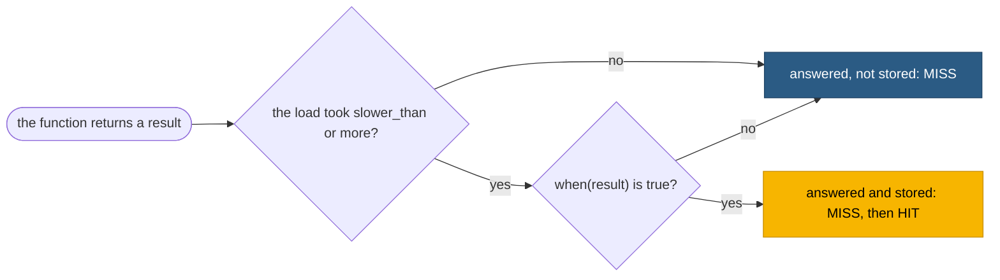
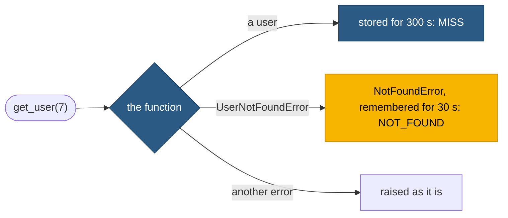

# What is stored, and for how long

How long a result stays fresh, with `ttl=`; which results are stored at all, with `Store`; and how
a "not found" is kept as an answer, with `Negative`.

## TTL from the result

When the result says how long it is valid, as a token does, give `ttl` a function of it:

=== "Sync"

    ```python
    --8<-- "caching_functions/ttl_from_result_sync.py:show"
    ```

=== "Async"

    ```python
    --8<-- "caching_functions/ttl_from_result_async.py:show"
    ```

!!! warning "A negative TTL is an error, not a way to skip a result"

    A result the function gives a negative TTL is not stored, and the error goes to `on_error`.
    To leave a result out on purpose use `Store(when=...)`.

## Storing only some results

By default every result is stored. `Store`, from `pashe.options`, keeps out the results not worth
keeping: one that will change soon, or one the source gives fast anyway.

| Option | Type | Default | Stores a result |
| --- | --- | --- | --- |
| `when` | `Callable[[R], bool] | None` | `None`, every result | only if it returns true for the result |
| `slower_than` | `float | int | timedelta` | `0`, every result | only if its load took at least this many seconds |

`R` is the type the function returns.



An order is final once it is done; until then its status changes, so caching it would answer
with an old status:

=== "Sync"

    ```python
    --8<-- "caching_functions/store_when_sync.py:show"
    --8<-- "caching_functions/store_when_sync.py:calls"
    ```

=== "Async"

    ```python
    --8<-- "caching_functions/store_when_async.py:show"
    --8<-- "caching_functions/store_when_async.py:calls"
    ```

`Store(slower_than=0.05)` keeps only results whose load took 50 ms or more: a fast query is
cheap to repeat, and the room in the cache goes to the slow ones.

A result left out is still answered, and the call reports `MISS`. The rule holds for every way a
result gets in: `get_order.set(order, 1)` and `refresh` with a result `when` refuses drop the
stored one instead of keeping it. `set` loads nothing, so `slower_than` does not apply to it. In
a batch `when` is checked per item, and `slower_than` against the load of the whole batch.

## Negative caching

A loader error that means "there is no such data" can be cached as the answer, so the source
is not asked again every time:



=== "Sync"

    ```python
    --8<-- "staleness/not_found_sync.py:show"
    ```

=== "Async"

    ```python
    --8<-- "staleness/not_found_async.py:show"
    ```

The cached function raises `NotFoundError` then, with the loader error as its cause when it just
loaded. A stale result never hides a "not found".

---

API reference: [`pashe`](../../reference/caches.md), [options](../../reference/options.md).
