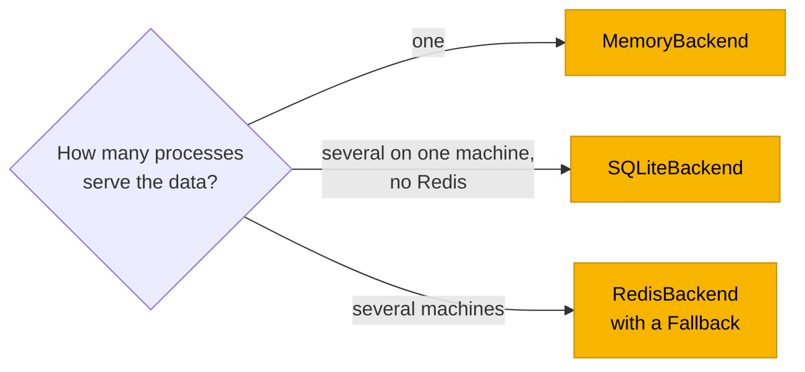
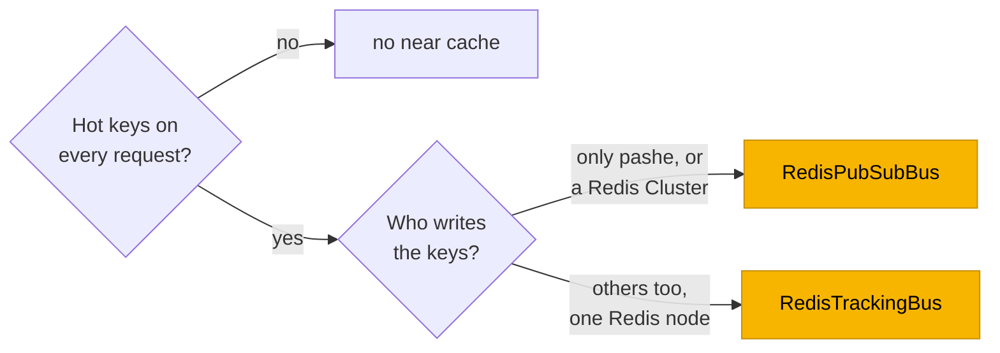

# What to choose

Every part of a cache has a few options. Each table below answers "which one" for one part, from
what you have to what you take; the page of each part tells the rest.

## Where each feature works

A feature that lives in the backend works for every process over that backend; one that lives in
the cache works in its process only, as [Core concepts](../concepts.md#where-each-feature-works) tells.

| Feature | Lives in | Over Redis, Valkey or a cluster | Over SQLite | Over memory |
| --- | --- | --- | --- | --- |
| cached results | the backend | every process of every machine | every process of one machine | one process |
| tags and `invalidate_tags` | the backend | every process of every machine | every process of one machine | one process |
| `lock`, `try_lock` and `@locked` | the backend | every process of every machine | every process of one machine | one process |
| `rate_limit` and `@rate_limited` | the backend | every process of every machine | every process of one machine | one process |
| `Stampede.lock_for` | the backend | every process of every machine | every process of one machine | one process, where `single_flight` does it for less |
| `Stampede.revalidate_before` | the backend | every process of every machine | every process of one machine | one process |
| `Stampede.single_flight` | the cache | one process | one process | one process |
| `Stampede.max_concurrent_loads` | the cache | one process | one process | one process |
| the copies of a near cache | the cache | one process | one process | one process |
| a `Fallback` | its own backend, memory as a rule | one process | one process | one process |

## Where entries live

| You have | Take | See |
| --- | --- | --- |
| one process, or tests | `MemoryBackend` | [Memory](backends/memory.md) |
| several processes on one machine and no Redis, or entries that outlive a restart | `SQLiteBackend` | [SQLite](backends/sqlite.md) |
| several processes or servers | `RedisBackend` | [Redis and Valkey](backends/redis.md) |
| Redis Cluster | `RedisBackend` over a `RedisCluster` client | [Redis Cluster](backends/cluster.md) |
| another store | a backend of your own | [Writing your own backend](backends/your-own.md) |

## A near cache, and its bus

A near cache keeps copies in process memory in front of the shared backend: a read it answers
costs no round trip, and a copy may be up to `local_ttl` old.

| You have | Take | See |
| --- | --- | --- |
| a key read by most requests, such as settings or a catalog | `NearCacheBackend` in front of Redis | [Near cache](backends/near-cache.md) |
| keys written as often as read, or no tolerance for a copy up to `local_ttl` old | no near cache | |
| a near cache, writes only through pashe | `RedisPubSubBus` | [Telling the other processes](backends/near-cache.md#telling-the-other-processes) |
| a near cache over a Redis Cluster | `RedisPubSubBus`: tracking follows one node | the same |
| a near cache, and other services or people write the same keys | `RedisTrackingBus`, on one Redis node of version 6 or later | the same |
| one process, or copies that may live out `local_ttl` | `NoOpBus`, the default | the same |
| sync code over one Redis node, no near cache of pashe | the client-side cache of redis-py | [Redis and Valkey](backends/redis.md) |

## A backend that fails

| You have | Take | See |
| --- | --- | --- |
| a Redis outage must not send every call to the source | `fallback=Fallback(MemoryBackend())` | [A failing backend](failures/failing-backend.md) |
| a Redis that is down makes every call wait for its timeout | `CircuitBreaker` given to `RedisBackend` | [Skip a backend that is down](failures/failing-backend.md#skip-a-backend-that-is-down) |
| no Redis outage worth planning for, as with memory or SQLite | neither | |

## How values are stored

| Your functions return | Take | See |
| --- | --- | --- |
| dataclasses, `TypedDict`s, `msgspec.Struct`s | `MsgspecMsgpackCodec`; `MsgspecJsonCodec` when other services read the values | [Codecs](values/codecs.md) |
| pydantic models | `PydanticCodec` | the same |
| plain `dict`s and `list`s | `OrjsonCodec`, or `JsonCodec`, the default, with no extra | the same |
| any object, read only by Python | `PickleCodec(secret=...)` | the same |

| Your values are | Take | See |
| --- | --- | --- |
| up to a kilobyte | no compressor, the default | [Compressors](values/compressors.md) |
| kilobytes or more, such as lists and pages | `ZstdCompressor` | the same |
| kilobytes or more, and no zstd | `GzipCompressor` | the same |

## How fresh a result is

| You have | Take | See |
| --- | --- | --- |
| a result that may be a little old, and calls that must be fast | `Stale(while_revalidate=...)`: the old result answers at once while one call reloads | [Stale results](failures/stale.md) |
| a source that fails now and then | `Stale(if_error=...)`: the old result answers its errors | the same |
| a source that is sometimes slow, and a deadline | `Stale(if_slow=IfSlow(...))`: the old result answers a slow load, which goes on | the same |
| a hot key that must never be seen stale | `Stampede(revalidate_before=...)`: it reloads in the last seconds of its TTL | [Reload before the TTL](failures/stampedes.md#reload-before-the-ttl) |
| a TTL that depends on the result, such as a token | `ttl=` a function of the result | [What is stored](caching/what-is-stored.md) |
| a write that changes what a result shows | tags, and `@cache.invalidates` or `invalidate_tags` | [Tags](invalidation/tags.md) |

## How loads are shared

"Reaches" is where it works over Redis; [the backend decides](#where-each-feature-works) for a
feature that lives in it.

| You have | Take | Reaches | See |
| --- | --- | --- | --- |
| concurrent calls of a key in one process | nothing: `Stampede(single_flight=True)` is the default | one process | [Stampede protection](failures/stampedes.md) |
| an expensive load, and many processes that miss the key at once | `Stampede(lock_for=...)`: one process loads, the others wait and take its result | every process | [Locking a load across processes](failures/stampedes.md#locking-a-load-across-processes) |
| a source that takes only so many loads at once | `Stampede(max_concurrent_loads=...)` | one process | [Limiting loads at once](failures/stampedes.md#limiting-loads-at-once) |
| many entries stored at once, such as after a deploy | `Stampede(jitter=0.1)`, so they do not expire together | every process | [Stampede protection](failures/stampedes.md) |
| "not found" asked again and again, such as for unknown ids | `Negative(on=(UserNotFoundError,), ttl=...)` | every process | [Negative caching](caching/what-is-stored.md#negative-caching) |

## Locks and rate limits

| You have | Take | Reaches | See |
| --- | --- | --- | --- |
| a block one process at a time may run | `with cache.lock(...)` | every process | [Locks](locks/locks.md) |
| a job that skips when another process runs it | `cache.try_lock(...)` | every process | the same |
| a function one process at a time may run, each call doing its work | `@cache.locked(...)` | every process | the same |
| a cached function whose load one process at a time may run, the others taking its result | `Stampede(lock_for=...)`, not `@cache.locked` | every process | [Locking a load across processes](failures/stampedes.md#locking-a-load-across-processes) |
| a limit such as "100 a minute", even across its windows | `SlidingWindow`, or `per_minute(100)` | every process | [Rate limits](locks/rate-limits.md) |
| a limit that bans for a while once it is passed, such as logins | `FixedWindow(..., ban_for=...)` | every process | the same |
| a limit of a whole ASGI application | `RateLimitMiddleware` of `pashe.asgi` | every process | [Rate limits for HTTP](web/rate-limits.md) |
| a limit of a FastAPI route, by the current user | `rate_limit` of `pashe.contrib.fastapi` | every process | [FastAPI](web/fastapi.md) |

## What the cache tells you

| You have | Take | See |
| --- | --- | --- |
| logs only | `LoggingHook`: without it no one sees a backend that is down | [Logging](observability/logging.md) |
| Prometheus | `PrometheusMetricsHook` | [Prometheus](observability/prometheus.md) |
| OpenTelemetry | `OtelMetricsHook`, and `OtelSpanEventsHook` for traces | [OpenTelemetry](observability/opentelemetry.md) |
| Sentry | `SentryHook` | [Sentry](observability/sentry.md) |
| HTTP caches in front of you, a CDN or a browser | `CacheHeadersMiddleware` | [HTTP caching headers](web/headers.md) |

A full setup for the common cases is on [Recommended setup](recommended-setup.md).
