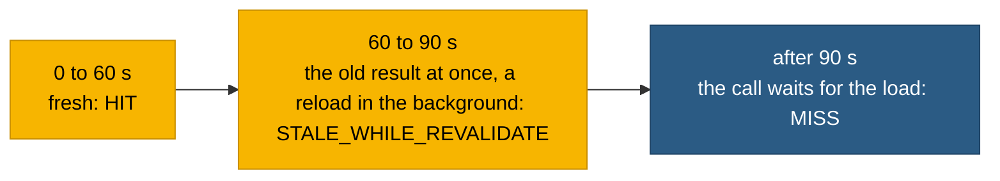
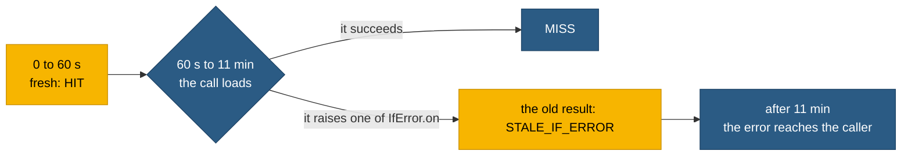
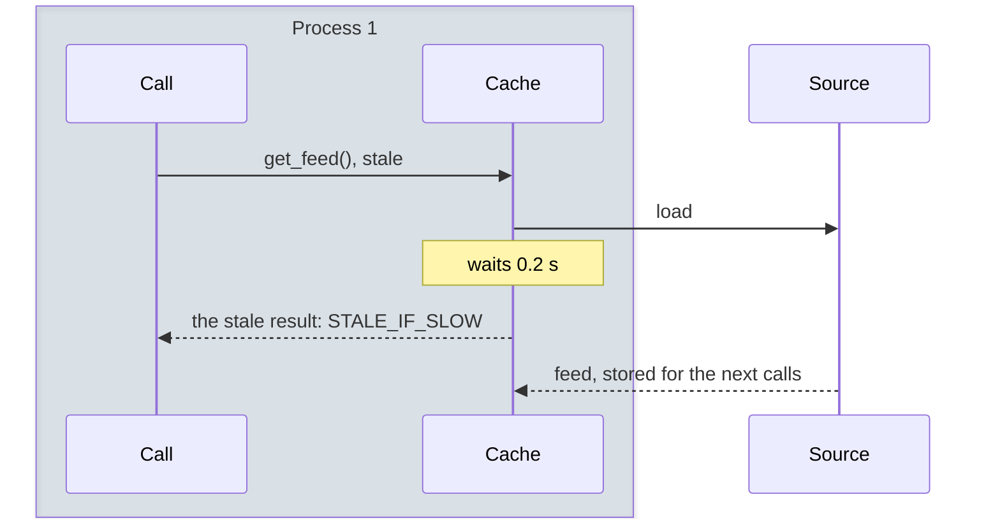

# Stale results

A stored result past its TTL is stale. Each window of `Stale`, from `pashe.options`, keeps it
answering for a while longer, in its own case; `0` turns a window off.

## Every option

Every window of `Stale` at once, as the [example of every option](../caching/decorator.md#every-option) of
`@cache(...)` gives it:

=== "Sync"

    ```python
    --8<-- "caching_functions/decorator_options_sync.py:stale"
    ```

=== "Async"

    ```python
    --8<-- "caching_functions/decorator_options_async.py:stale"
    ```

API reference: [`Stale`](../../reference/options.md#pashe.options.Stale).

## Stale while revalidate

=== "Sync"

    ```python
    --8<-- "staleness/while_revalidate_sync.py:show"
    ```

=== "Async"

    ```python
    --8<-- "staleness/while_revalidate_async.py:show"
    ```



For 30 seconds after the TTL a call is answered at once with the stale result, and one caller
reloads it in the background. Callers never wait for the source while the window lasts. To
reload before the result goes stale, see
[Reload before the TTL](stampedes.md#reload-before-the-ttl).

## Stale if error

=== "Sync"

    ```python
    --8<-- "staleness/if_error_sync.py:show"
    ```

=== "Async"

    ```python
    --8<-- "staleness/if_error_async.py:show"
    ```



For 10 minutes after the TTL, a load that raises one of `IfError.on` is answered with the
stale result instead; the error goes to `on_error`. `if_error=600`, a plain duration, counts
every `Exception`.

!!! tip "A circuit breaker composes with it"

    Decorate the function with a breaker of another library, under the cache: while the breaker
    is open, its error is answered with the stale result without waiting for the source.

## Stale if slow

=== "Sync"

    ```python
    --8<-- "staleness/if_slow_sync.py:show"
    ```

=== "Async"

    ```python
    --8<-- "staleness/if_slow_async.py:show"
    ```



A call waits at most 0.2 seconds for the function; past it the stale result answers and the load
goes on in the background. `IfSlow` takes both: how long the window lasts, and how long a call
waits.

---

API reference: [`pashe.options`](../../reference/options.md).
