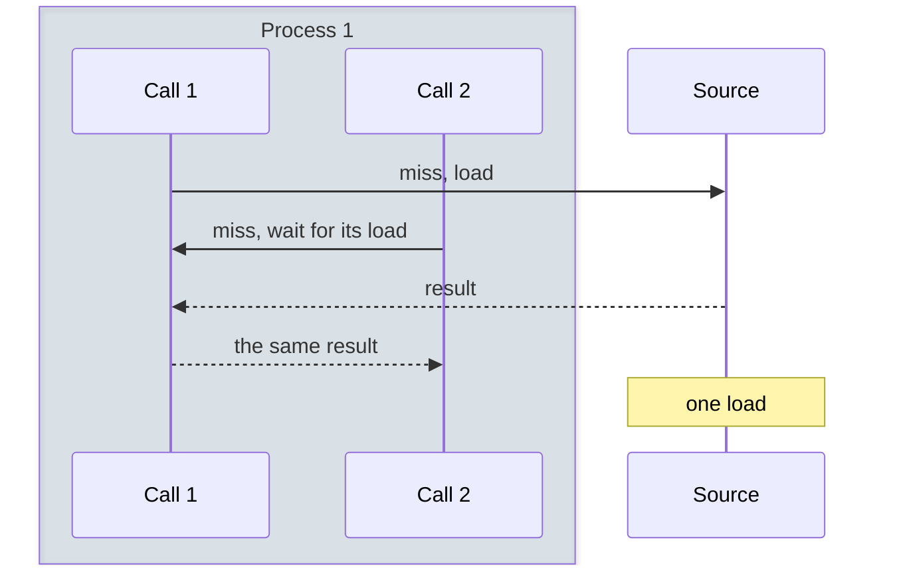
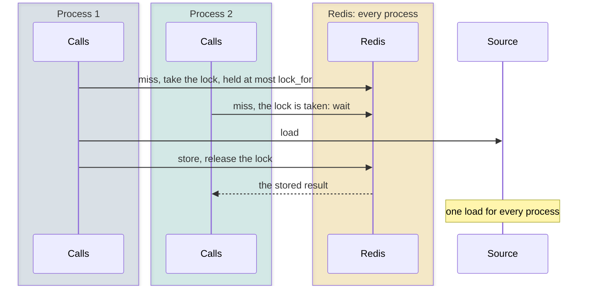
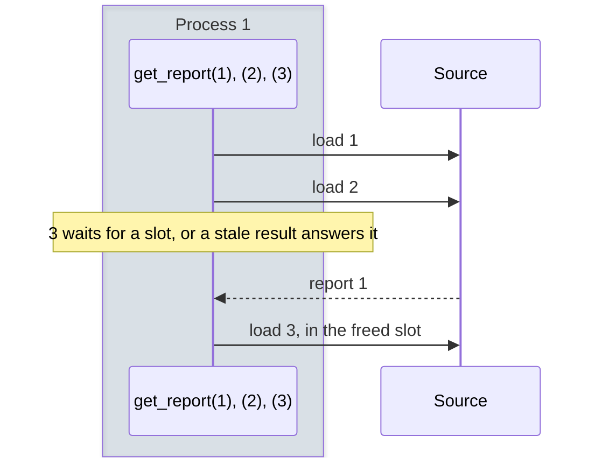

# Stampede protection

When a popular key expires, every caller misses at once and asks the source. The options of
`Stampede`, from `pashe.options`, share the load.

=== "Sync"

    ```python
    --8<-- "stampedes/lock_for_sync.py:show"
    ```

=== "Async"

    ```python
    --8<-- "stampedes/lock_for_async.py:show"
    ```

`share_loads` and `max_loads` work in the process; `lock_for` and `revalidate_before` hold a lock in the
backend, so they reach every process over it: [Where each feature works](../choosing.md#where-each-feature-works).

`lock_for` is the longest the lock is held, so a process that dies holding it frees it.

A call over `max_loads` waits for a slot; when a stale result can answer it, that result answers
at once instead, and the hooks hear an `OverloadedError`.

!!! warning "Concurrent callers share one object"

    With `share_loads` concurrent callers of a key get the same object: copy a result before
    you change it.

API reference: [`Stampede`](../../reference/options.md#pashe.options.Stampede).

## Every option

Every option at once, as the [example of every option](../caching/decorator.md#every-option) of
`@cache(...)` gives it:

=== "Sync"

    ```python
    --8<-- "caching_functions/decorator_options_sync.py:stampede"
    ```

=== "Async"

    ```python
    --8<-- "caching_functions/decorator_options_async.py:stampede"
    ```

## Sharing a load within a process

Calls of one key at the same time in one process share one load. It is on by default.



## Locking a load across processes

`share_loads` leaves one load per process; with ten processes that is ten loads. A load lock
in Redis leaves one for all of them.



## Limiting loads at once

A limit of loads of one function in one process, whatever their keys: here, `max_loads=2`.



## Reload before the TTL

A key read all the time still expires, and the calls right after it miss or answer stale. With
`revalidate_before` the result is reloaded while it is still fresh: here, the calls of its last
10 seconds get it at once, a HIT, and one caller reloads it in the background.

=== "Sync"

    ```python
    --8<-- "stampedes/revalidate_before_sync.py:show"
    ```

=== "Async"

    ```python
    --8<-- "stampedes/revalidate_before_async.py:show"
    ```


The reload holds a lock in the backend, so one process reloads a key at a time; a failed reload
goes to `on_error`, and the result answers until its TTL, then as `Stale` says. A key nobody
reads in those seconds expires as without it. Unlike `Stale(while_revalidate=...)`, no call
gets a result past its TTL; the price is a load a little more often. A batch takes none.

---

API reference: [`pashe.options`](../../reference/options.md).
