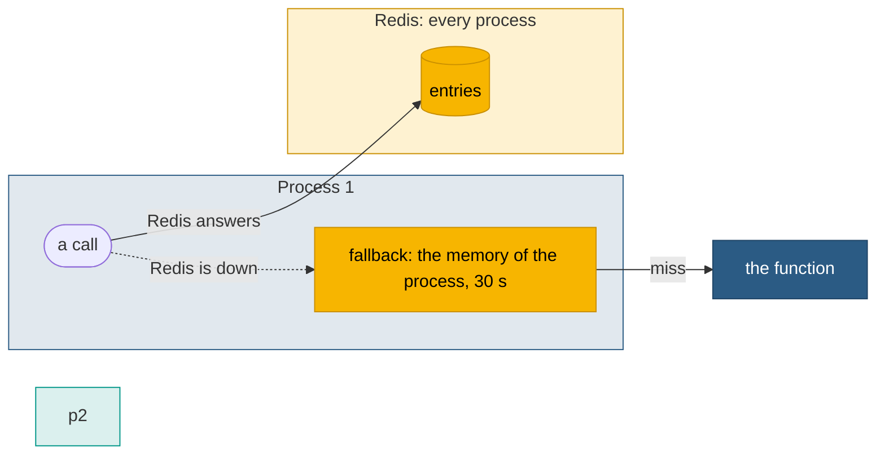

# A failing backend

Redis goes down. What happens to your cached functions? They keep working: each call loads from
the source, and the error goes to `on_error`. But now every call hits the source. A
[`Fallback`][pashe.options.Fallback] keeps those results for a while, so the source gets one load
per key and process instead of one per call:

=== "Sync"

    ```python
    --8<-- "staleness/fallback_sync.py"
    ```

=== "Async"

    ```python
    --8<-- "staleness/fallback_async.py"
    ```



!!! warning "No invalidation reaches the fallback"

    While Redis is down, `invalidate_tags` and `invalidate` can't reach the fallback. So a result
    stays there for at most [`Fallback.ttl`][pashe.options.Fallback(ttl)], 30 seconds by default.
    A longer TTL spares the source more; a shorter one means calls get old results for less time.

## Skip a backend that is down

Until Redis is back, every call waits for its connection's timeout before it loads. Two settings
cut that wait short: short client timeouts, and a
[`CircuitBreaker`][pashe.backends.CircuitBreaker] from `pashe.backends`. The breaker skips Redis
for a while once it has failed several times in a row:

=== "Sync"

    ```python hl_lines="10 11 13 14"
    --8<-- "backends/breaker_sync.py:show"
    ```

=== "Async"

    ```python hl_lines="10 11 13 14"
    --8<-- "backends/breaker_async.py:show"
    ```

| Calls | What happens |
| --- | --- |
| the first 5 while Redis is down | each waits for the client's timeout, then gets its result from the fallback or the source |
| the next ones, for 10 s | each skips Redis at once: [`CircuitOpenError`][pashe.errors.CircuitOpenError], a `BackendError`, goes to `on_error` |
| after 10 s | one call tries Redis: if Redis answers, the breaker closes; if it fails, the breaker opens for 10 s more |

Does a near cache use the same Redis? Give its bus the same breaker,
`RedisPubSubBus(client, breaker=breaker)`, so both skip Redis together. A hook hears when the
breaker opens and closes through `on_circuit`, so you can alert when Redis is down.

A backend takes any [`Breaker`][pashe.backends.Breaker] from `pashe.backends`. For another policy,
subclass it.
