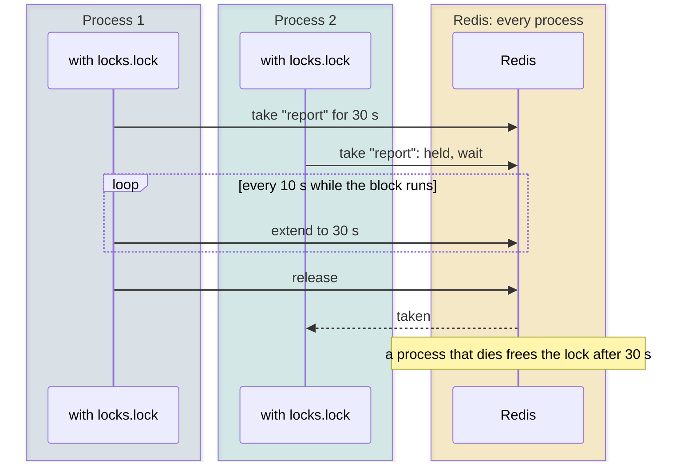

# Locks

Some work must run in one process at a time, even when you run many. [`Locks`][pashe.Locks],
from `pashe`, takes locks that live in a backend, so every process that uses it shares them: one
holder at a time, in any process. [`AsyncLocks`][pashe.AsyncLocks] is the async side. You can:

- [take a lock](#taking-a-lock) around a block;
- [run a function under one](#locking-a-function);
- [skip work](#taking-a-lock-if-it-is-free) that someone else is already doing;
- [limit the wait](#a-limit-on-the-wait);
- [let several holders in](#several-holders).

Locks don't mix with a cache's entries, even over the same backend and `prefix`. They don't close
anything either: the backend belongs to whoever created it.

!!! info "Where it works"

    In the backend. Over Redis that's every process on every machine, over SQLite every process
    on one machine, and over memory one process. See
    [Where each feature works](choosing.md#where-each-feature-works).

## Taking a lock

Say only one process at a time should build a report. Wrap that block in
[`locks.lock`][pashe.Locks.lock]: it gives you a [`Lock`][pashe.locks.Lock], held for
[`ttl`][pashe.Locks.lock(ttl)].

=== "Sync"

    ```python hl_lines="14"
    --8<-- "locks_and_rate_limits/lock_sync.py:show"
    ```

=== "Async"

    ```python hl_lines="15"
    --8<-- "locks_and_rate_limits/lock_async.py:show"
    ```



The lock is extended while the block runs, so the block can run longer than `ttl`. The `ttl`
only matters when a process dies: then its lock frees itself.

!!! warning "A lost lock"

    The lock can expire while the block runs, for example when Redis was unreachable for longer
    than `ttl`. Then someone else may hold it now, and you get
    [`LockLostError`][pashe.errors.LockLostError]. A sync block runs to its end first, since a
    thread can't be interrupted. An async block is cancelled right away.

## Locking a function

[`@locks.locked`][pashe.Locks.locked] runs every call of a function under a lock, as if you put
`with locks.lock(...)` around it. Its [`key`][pashe.Locks.locked(key)] is a template over the
arguments, the same as for `@cache`. Without a key, all calls of the function share one lock.

=== "Sync"

    ```python hl_lines="11"
    --8<-- "locks_and_rate_limits/locked_sync.py:show"
    ```

=== "Async"

    ```python hl_lines="11"
    --8<-- "locks_and_rate_limits/locked_async.py:show"
    ```

!!! tip "A lock for a cached function is `Stampede(lock_for=...)`"

    With `@locks.locked`, each waiter runs the function itself once the lock is free. Do you want
    one load for the whole service, with the waiters getting its result? Then give the cached
    function `stampede=Stampede(lock_for=...)` instead: see
    [Locking a load across processes](stampedes.md#locking-a-load-across-processes).

## Taking a lock if it is free

If another process is already building the report, there's no need to wait for it.
[`try_lock`][pashe.Locks.try_lock] takes the lock only if it's free right now, and gives you
`None` when someone holds it.

=== "Sync"

    ```python hl_lines="14"
    --8<-- "locks_and_rate_limits/try_lock_sync.py:show"
    ```

=== "Async"

    ```python hl_lines="15"
    --8<-- "locks_and_rate_limits/try_lock_async.py:show"
    ```

It never waits, so it doesn't take a `timeout`.

## A limit on the wait

By default, entering a lock waits as long as someone else holds it, with no limit. Set
[`timeout`][pashe.Locks.lock(timeout)] to cap the wait: when it runs out, you get
[`LockTimeoutError`][pashe.errors.LockTimeoutError].

=== "Sync"

    ```python hl_lines="17"
    --8<-- "locks_and_rate_limits/timeout_sync.py:show"
    ```

=== "Async"

    ```python hl_lines="17"
    --8<-- "locks_and_rate_limits/timeout_async.py:show"
    ```

## Several holders

Sometimes a few at once is fine, but not more. [`holders`][pashe.Locks.lock(holders)] lets that
many hold a lock at the same time, like a semaphore across processes. With `holders=3`, a fourth
waits while three hold it.

=== "Sync"

    ```python hl_lines="11 16"
    --8<-- "locks_and_rate_limits/holders_sync.py:show"
    ```

=== "Async"

    ```python hl_lines="11 16"
    --8<-- "locks_and_rate_limits/holders_async.py:show"
    ```

Each holder is extended and released on its own.

!!! warning "One number of holders for a key"

    Use the same `holders` everywhere you lock a key. Each holder takes one of that many keys in
    the backend, and the first one is the key itself. A lock on the key with fewer holders checks
    fewer of them, and lets in more than either number says.

## Every option

=== "Sync"

    ```python
    --8<-- "locks_and_rate_limits/lock_options_sync.py:show"
    ```

=== "Async"

    ```python
    --8<-- "locks_and_rate_limits/lock_options_async.py:show"
    ```
