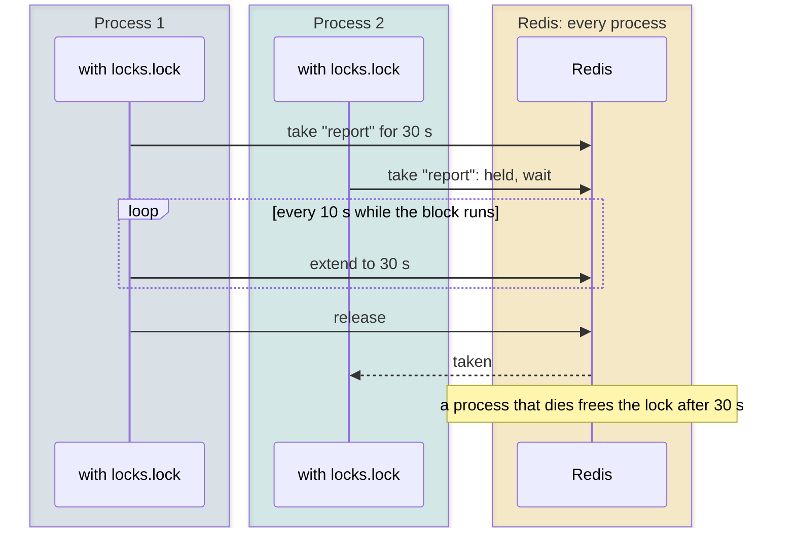

# Locks

[`Locks`][pashe.Locks] of `pashe`, [`AsyncLocks`][pashe.AsyncLocks] on the async side, takes locks
that live in a backend, so every process over it shares them: one holder at a time, in any
process. A block [takes a lock](#taking-a-lock), a function [runs under one](#locking-a-function),
work someone else does already is [skipped](#taking-a-lock-if-it-is-free), and a lock can
[bound the wait](#a-limit-on-the-wait) or [let several in](#several-holders). The locks live apart
from the entries of a cache over the same backend and `prefix`, and close nothing: the backend
belongs to whoever made it.

!!! info "Where it works"

    In the backend: every process of every machine over Redis, every process of one machine over
    SQLite, one process over memory. See [Where each feature works](choosing.md#where-each-feature-works).

## Taking a lock

A block that one process at a time may run, such as building a report, takes a lock for it with
[`locks.lock`][pashe.Locks.lock], a [`Lock`][pashe.locks.Lock] held for
[`ttl`][pashe.Locks.lock(ttl)].

=== "Sync"

    ```python hl_lines="10"
    --8<-- "locks_and_rate_limits/lock_sync.py:show"
    ```

=== "Async"

    ```python hl_lines="11"
    --8<-- "locks_and_rate_limits/lock_async.py:show"
    ```



The lock is extended while the block runs, so the block may run longer than `ttl`; the `ttl` only
frees the lock of a process that died.

!!! warning "A lost lock"

    If the lock expires while the block runs, as when Redis was unreachable for longer than
    `ttl`, someone else may hold it now, and [`LockLostError`][pashe.errors.LockLostError] is
    raised: a sync block runs to its end first, as a thread cannot be interrupted; an async block
    is cancelled at once.

## Locking a function

[`@locks.locked`][pashe.Locks.locked] runs every call of a function under a lock, as
`with locks.lock(...)` around it. Its [`key`][pashe.Locks.locked(key)] is a template over the
arguments, as of `@cache`; without one, the function has one lock for every call.

=== "Sync"

    ```python hl_lines="7"
    --8<-- "locks_and_rate_limits/locked_sync.py:show"
    ```

=== "Async"

    ```python hl_lines="7"
    --8<-- "locks_and_rate_limits/locked_async.py:show"
    ```

!!! tip "A lock for a cached function is `Stampede(lock_for=...)`"

    A waiter of `@locks.locked` runs the function itself once the lock is free. To load a cached
    result once for the whole service, with the waiters taking that result, give the cached function
    `stampede=Stampede(lock_for=...)` instead: see [Locking a load across processes](stampedes.md#locking-a-load-across-processes).

## Taking a lock if it is free

Work that someone else is doing already, such as a report another process builds, need not wait:
[`try_lock`][pashe.Locks.try_lock] takes the lock only if it is free now, and gives `None` when
it is held.

=== "Sync"

    ```python hl_lines="10"
    --8<-- "locks_and_rate_limits/try_lock_sync.py:show"
    ```

=== "Async"

    ```python hl_lines="11"
    --8<-- "locks_and_rate_limits/try_lock_async.py:show"
    ```

It never waits, so it takes no `timeout`.

## A limit on the wait

Entering a lock waits as long as someone else holds it, with no limit;
[`timeout`][pashe.Locks.lock(timeout)] bounds the wait and raises
[`LockTimeoutError`][pashe.errors.LockTimeoutError].

=== "Sync"

    ```python hl_lines="13"
    --8<-- "locks_and_rate_limits/timeout_sync.py:show"
    ```

=== "Async"

    ```python hl_lines="13"
    --8<-- "locks_and_rate_limits/timeout_async.py:show"
    ```

## Several holders

[`holders`][pashe.Locks.lock(holders)] lets a lock be held by that many at once, as a semaphore across processes: a fourth
waits while three hold `holders=3`.

=== "Sync"

    ```python hl_lines="7 12"
    --8<-- "locks_and_rate_limits/holders_sync.py:show"
    ```

=== "Async"

    ```python hl_lines="7 12"
    --8<-- "locks_and_rate_limits/holders_async.py:show"
    ```

Every holder is extended and released on its own.

!!! warning "One number of holders for a key"

    Every use of a key takes the same `holders`. Each holder takes one of as many keys in the
    backend, the first of them the key itself; a lock of the key with fewer holders checks fewer
    of them, and lets more in than either number says.

## Every option

=== "Sync"

    ```python
    --8<-- "locks_and_rate_limits/lock_options_sync.py:show"
    ```

=== "Async"

    ```python
    --8<-- "locks_and_rate_limits/lock_options_async.py:show"
    ```
