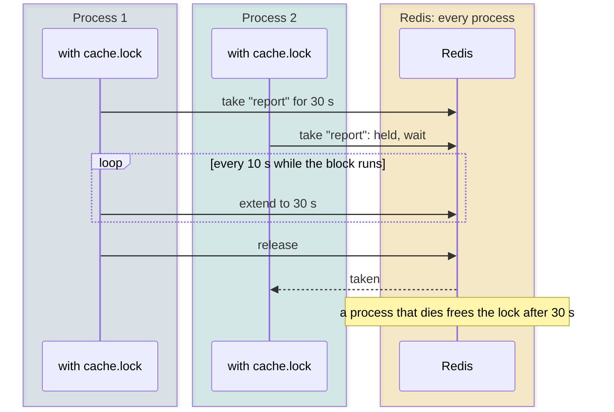

# Locks

`cache.lock`, `cache.try_lock` and `@cache.locked` take a lock that lives in the backend, so every
process that uses it shares it: one holder at a time, in any process.



=== "Sync"

    ```python
    --8<-- "locks_and_rate_limits/lock_sync.py:show"
    ```

=== "Async"

    ```python
    --8<-- "locks_and_rate_limits/lock_async.py:show"
    ```

Entering waits while someone else holds the lock; `timeout` bounds the wait and raises
`LockTimeoutError`. While the block runs the lock is extended every third of `ttl`, so the block
may run longer than `ttl`; the `ttl` frees the lock if the process dies.

!!! warning "A lost lock"

    If the lock expires while the block runs, as when Redis was unreachable for longer than
    `ttl`, someone else may hold it now, and `LockLostError` is raised: a sync block runs to its
    end first, as a thread cannot be interrupted; an async block is cancelled at once.

=== "Sync"

    ```python
    --8<-- "locks_and_rate_limits/try_lock_sync.py:show"
    ```

=== "Async"

    ```python
    --8<-- "locks_and_rate_limits/try_lock_async.py:show"
    ```

---

API reference: [`pashe.locks`](../../reference/locks.md).
