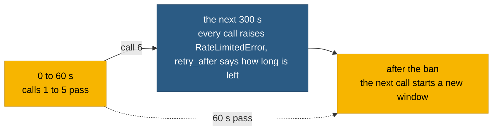

# Rate limits

`cache.rate_limit` and `@cache.rate_limited` count calls for a key in the backend, so every process that uses it shares the
count, and refuses those over the limit with `RateLimitedError`.

!!! info "Where it works"

    In the backend: every process of every machine over Redis, every process of one machine over
    SQLite, one process over memory. See [Where each feature works](../choosing.md#where-each-feature-works).

=== "Sync"

    ```python
    --8<-- "locks_and_rate_limits/rate_limit_sync.py:show"
    ```

=== "Async"

    ```python
    --8<-- "locks_and_rate_limits/rate_limit_async.py:show"
    ```

| Limit | Counts |
| --- | --- |
| `SlidingWindow(calls=100, per=60)` | about `calls` calls in any span of `per` seconds; refused calls are not counted |
| `FixedWindow(calls=5, per=60, ban_for=300)` | `calls` per window that starts with the first call; the first call over it blocks the key for `ban_for` |
| `per_second(n)`, `per_minute(n)`, `per_hour(n)` | sliding windows |

A `FixedWindow` with a ban, as the table says:



`RateLimitedError.retry_after` says how long to wait, for a `Retry-After` header. `cost` counts a
heavy call as several. A failing backend lets the call through uncounted and reports to `on_error`.

Each limit keeps counters of its own, named by the key and the limit. Two limits on one key, such
as 10 calls a minute and 100 an hour for one address, count apart, and a call passes when every
one of them lets it. One limit used in two places on one key shares its counters.

## Every option

=== "Sync"

    ```python
    --8<-- "locks_and_rate_limits/rate_limit_options_sync.py:show"
    ```

=== "Async"

    ```python
    --8<-- "locks_and_rate_limits/rate_limit_options_async.py:show"
    ```

`rate_limit` returns a `RateLimitState` of `pashe.ratelimit`: the calls of the limit, those left,
and the seconds until the window resets.

!!! warning "A limit is checked in a few calls to the backend, not at once"

    A sliding window adds the call to its counter, reads the last window, and takes the call back
    if it is over the limit; a fixed window adds the call, then reads or sets the time left. In
    between, other processes see the call counted: under a burst right at the limit, a few calls
    may be refused that a single check would let through. Calls over the limit are never let
    through.

!!! tip "Fail closed where a limit guards against abuse"

    For limits of logins or of password resets, pass `fail_open=False`: a failing backend then
    raises `BackendError` instead of letting every call through.

---

API reference: [`pashe.ratelimit`](../../reference/ratelimit.md).
