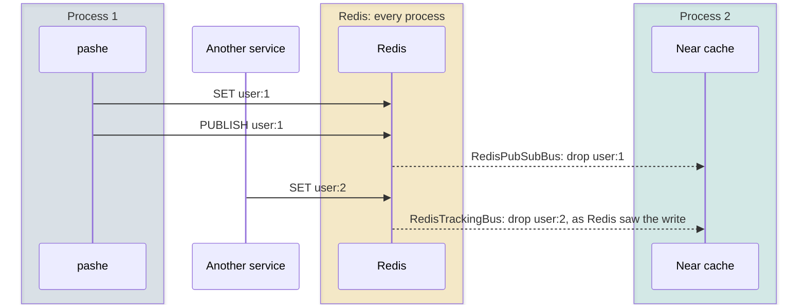

# Near cache

[`NearCacheBackend`][pashe.backends.NearCacheBackend], a near cache, keeps copies of hot keys in the
memory of each process, in front of a shared backend such as Redis. A read of a copy does not leave
the process: hot keys do not load one Redis node, and reads go on for a while when Redis is slow.

The copies live in each process; the bus tells every process over the shared backend to drop
them: [Where each feature works](choosing.md#where-each-feature-works).

## A near cache in front of Redis

Every read of a hot key goes to one Redis node; a copy in the memory of the process answers it
there instead. `local` is a `MemoryBackend`, and `AsyncNearCacheBackend` is the async side.

=== "Sync"

    ```python hl_lines="8-11"
    --8<-- "backends/near_cache_sync.py:show"
    ```

=== "Async"

    ```python hl_lines="8-11"
    --8<-- "backends/near_cache_async.py:show"
    ```


How it reads and writes:

1. A read looks in the local memory first. A copy answers at once.
2. A key without a copy is read from the shared backend, and the value is copied to local memory
   for `local_ttl` seconds. The limits of `local` bound the copies: `MemoryBackend(max_entries=...)`,
   `1000` by default.
3. A write goes to the shared backend and drops the local copy of the key, so this process reads
   the new value next.
4. Other processes still hold their copies. Without a bus each answers with its copy for up to
   `local_ttl`: that is how stale a near cache may be. A bus tells them at once.

## How long a copy lives

A copy may answer for [`local_ttl`][pashe.backends.NearCacheBackend(local_ttl)], 5 seconds by
default, after another process wrote its key, when no bus tells of the
write; a shorter one keeps copies fresher, at the price of more reads of the shared backend.

=== "Sync"

    ```python hl_lines="10"
    --8<-- "backends/near_cache_local_ttl_sync.py:show"
    ```

=== "Async"

    ```python hl_lines="10"
    --8<-- "backends/near_cache_local_ttl_async.py:show"
    ```

## Telling the other processes

A [`bus`][pashe.backends.NearCacheBackend(bus)] carries "these keys changed" between the near caches
of every process; only the names of keys travel, never values. A near cache starts listening to its
bus on its first read, and a process that hears of a key drops its copy: its next read goes to the
shared backend.



| Bus | How it learns of a change | Sees writes of | Needs |
| --- | --- | --- | --- |
| [`RedisPubSubBus`][pashe.contrib.redis.RedisPubSubBus] | the writer publishes the keys it changed on a channel | pashe only | any Redis, Valkey, a Redis Cluster |
| [`RedisTrackingBus`][pashe.contrib.redis.RedisTrackingBus] | Redis tells, with `CLIENT TRACKING` in broadcasting mode | anyone: pashe, other services, `redis-cli` | Redis or Valkey 6 or later, one node |

### Writes through pashe

When every write goes through pashe, the near cache that writes publishes the keys it changed on
a [`channel`][pashe.contrib.redis.RedisPubSubBus(channel)]; `AsyncRedisPubSubBus` is the async
side.

=== "Sync"

    ```python hl_lines="10"
    --8<-- "backends/pubsub_bus_sync.py:show"
    ```

=== "Async"

    ```python hl_lines="10"
    --8<-- "backends/pubsub_bus_async.py:show"
    ```

Give every process of one cache the same channel, and two caches that must not hear each other
different ones. Writes made past pashe, by another service or by hand, are not published: those
copies live out `local_ttl`.

Near caches may share a bus and its client. The async client of a Redis Cluster has pub/sub
from redis-py 8: before it, `AsyncRedisPubSubBus` refuses it with `InvalidOptionsError`.

### Every write, whoever made it

When other services or people write the same keys, Redis itself tells about every write under a
[`prefix`][pashe.contrib.redis.RedisTrackingBus(prefix)], whoever made it, so pashe publishes
nothing; `AsyncRedisTrackingBus` is the async side.

=== "Sync"

    ```python hl_lines="10"
    --8<-- "backends/tracking_bus_sync.py:show"
    ```

=== "Async"

    ```python hl_lines="10"
    --8<-- "backends/tracking_bus_async.py:show"
    ```

!!! warning "Give it the prefix of the cache"

    The prefix is `""` by default, so every process hears of every write to the whole Redis. Give
    it the prefix of the cache, such as `prefix="app:"`.

Tracking in broadcasting mode costs the server no memory. The bus listens on a connection of its
own; on a Redis Cluster a node tracks only its own keys, so take `RedisPubSubBus` there.

!!! note

    `RedisTrackingBus` needs Redis or Valkey 6 or later; a clone of Redis without
    `CLIENT TRACKING`, such as some versions of Dragonfly, takes `RedisPubSubBus`.

### When messages are lost

A message sent while a process is disconnected never reaches it. So whenever a bus cannot be
sure it heard everything, as after an error of its connection, the near cache drops all its
copies, and listens again by itself. A publish that failed is not raised, as the write itself
succeeded; the other processes then drop their copies within `local_ttl` at the latest.

## Writing your own bus

For another transport such as NATS or Kafka, subclass
[`InvalidationBus`][pashe.invalidation.InvalidationBus], or `AsyncInvalidationBus`, from
`pashe.invalidation`, and pass it as `bus=`: it reaches wherever the transport does. It has two
methods, [`publish`][pashe.invalidation.InvalidationBus.publish] and
[`listen`][pashe.invalidation.InvalidationBus.listen].
