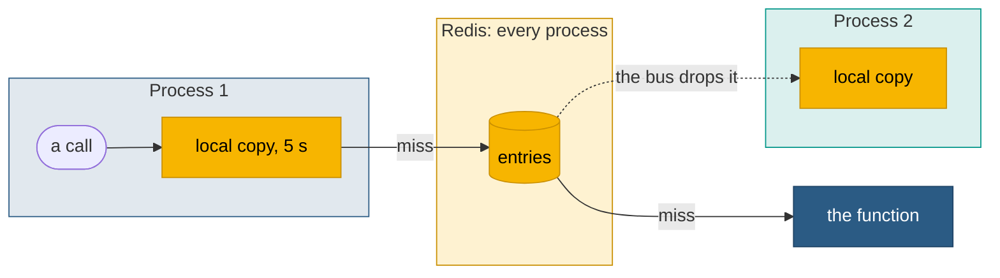
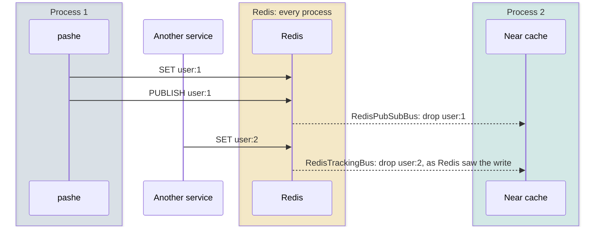

# Near cache

A few hot keys can send most of your reads to one Redis node. A near cache,
[`NearCacheBackend`][pashe.backends.NearCacheBackend], keeps copies of hot keys in each process's
memory, in front of a shared backend such as Redis. Reading a copy never leaves the process. Hot
keys stop loading one Redis node, and reads keep working for a while when Redis is slow.

Each process has its own copies. The bus tells every process that uses the shared backend when to
drop them: see [Where each feature works](choosing.md#where-each-feature-works).

## A near cache in front of Redis

Without a near cache, every read of a hot key goes to the same Redis node. With one, a copy in
the process's memory answers the read right there. `local` is a `MemoryBackend`, and
`AsyncNearCacheBackend` is the async side.

=== "Sync"

    ```python hl_lines="8-11"
    --8<-- "backends/near_cache_sync.py:show"
    ```

=== "Async"

    ```python hl_lines="8-11"
    --8<-- "backends/near_cache_async.py:show"
    ```



How it reads and writes:

1. A read looks in local memory first. If there's a copy, you get it right away.
2. If there's no copy, the read goes to the shared backend, and the value is copied to local memory
   for `local_ttl` seconds. The limits of `local` cap the number of copies:
   `MemoryBackend(max_entries=...)`, `1000` by default.
3. A write goes to the shared backend and drops this process's copy of the key, so the next read
   here gets the new value.
4. Other processes still have their copies. Without a bus, each keeps returning its copy for up to
   `local_ttl`: that's how stale a near cache can get. With a bus, they hear about the write right
   away.

## How long a copy lives

When another process writes a key and no bus tells you, your copy can still be returned for
[`local_ttl`][pashe.backends.NearCacheBackend(local_ttl)], 5 seconds by default. A shorter
`local_ttl` keeps copies fresher, but you read the shared backend more often.

=== "Sync"

    ```python hl_lines="10"
    --8<-- "backends/near_cache_local_ttl_sync.py:show"
    ```

=== "Async"

    ```python hl_lines="10"
    --8<-- "backends/near_cache_local_ttl_async.py:show"
    ```

## Telling the other processes

A [`bus`][pashe.backends.NearCacheBackend(bus)] carries "these keys changed" between the near
caches in every process. Only key names travel, never values. A near cache starts listening to its
bus on its first read. When a process hears about a key, it drops its copy, so its next read goes
to the shared backend.



| Bus | How it learns of a change | Sees writes of | Needs |
| --- | --- | --- | --- |
| [`RedisPubSubBus`][pashe.contrib.redis.RedisPubSubBus] | the writer publishes the keys it changed on a channel | pashe only | any Redis, Valkey, a Redis Cluster |
| [`RedisTrackingBus`][pashe.contrib.redis.RedisTrackingBus] | Redis tells, with `CLIENT TRACKING` in broadcasting mode | anyone: pashe, other services, `redis-cli` | Redis or Valkey 6 or later, one node |

### Writes through pashe

If every write goes through pashe, the near cache that writes publishes the changed keys on a
[`channel`][pashe.contrib.redis.RedisPubSubBus(channel)]. `AsyncRedisPubSubBus` is the async
side.

=== "Sync"

    ```python hl_lines="10"
    --8<-- "backends/pubsub_bus_sync.py:show"
    ```

=== "Async"

    ```python hl_lines="10"
    --8<-- "backends/pubsub_bus_async.py:show"
    ```

Give every process of one cache the same channel. Two caches that shouldn't hear each other get
different channels. Writes that skip pashe, from another service or by hand, aren't published, so
those copies live out their `local_ttl`.

Near caches can share a bus and its client. The async Redis Cluster client has pub/sub from
redis-py 8 on. With an older redis-py, `AsyncRedisPubSubBus` refuses it with
`InvalidOptionsError`.

### Every write, whoever made it

What if other services or people write the same keys? Then let Redis itself report every write
under a [`prefix`][pashe.contrib.redis.RedisTrackingBus(prefix)], whoever made it. pashe publishes
nothing. `AsyncRedisTrackingBus` is the async side.

=== "Sync"

    ```python hl_lines="10"
    --8<-- "backends/tracking_bus_sync.py:show"
    ```

=== "Async"

    ```python hl_lines="10"
    --8<-- "backends/tracking_bus_async.py:show"
    ```

!!! warning "Give it the cache's prefix"

    The prefix is `""` by default, so every process hears about every write to the whole Redis.
    Give it the cache's prefix, such as `prefix="app:"`.

Tracking in broadcasting mode costs the server no memory. The bus listens on its own connection.
On a Redis Cluster, each node tracks only its own keys, so use `RedisPubSubBus` there.

!!! note

    `RedisTrackingBus` needs Redis or Valkey 6 or later. For a Redis clone without
    `CLIENT TRACKING`, such as some versions of Dragonfly, use `RedisPubSubBus`.

### When messages are lost

A message sent while a process is disconnected never reaches it. So whenever a bus can't be sure
it heard everything, say after a connection error, the near cache drops all its copies and starts
listening again on its own.

A failed publish isn't raised, because the write itself succeeded. The other processes then drop
their copies within `local_ttl` at the latest.

## Writing your own bus

Using another transport, such as NATS or Kafka? Subclass
[`InvalidationBus`][pashe.invalidation.InvalidationBus], or `AsyncInvalidationBus`, from
`pashe.invalidation`, and pass it as `bus=`. It reaches wherever your transport does. You write two
methods: [`publish`][pashe.invalidation.InvalidationBus.publish] and
[`listen`][pashe.invalidation.InvalidationBus.listen].
