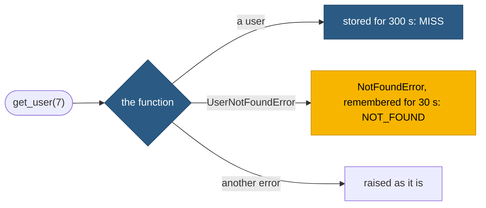

# Negative caching

Someone asks for user 7, and there's no user 7. Without a cache, every request for user 7 asks the
source again, and gets the same answer. [`Negative`][pashe.options.Negative] caches that "not
found" instead. List the errors that mean "there's no such data" in
[`on`][pashe.options.Negative(on)], and pashe keeps each one for [`ttl`][pashe.options.Negative(ttl)].

=== "Sync"

    ```python hl_lines="21"
    --8<-- "staleness/not_found_sync.py:show"
    ```

=== "Async"

    ```python hl_lines="21"
    --8<-- "staleness/not_found_async.py:show"
    ```



While a "not found" is kept, the cached function raises
[`NotFoundError`][pashe.errors.NotFoundError]. When the call has loaded right now, your function's
error is its cause. A stale result never hides a "not found".
