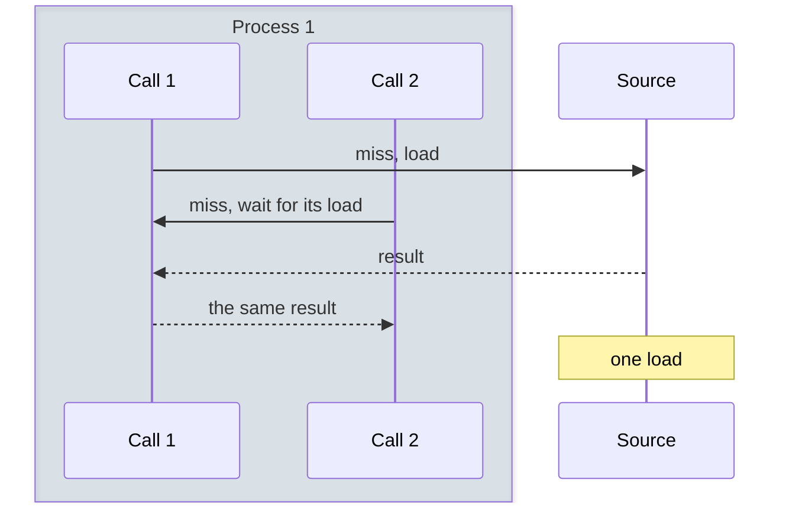
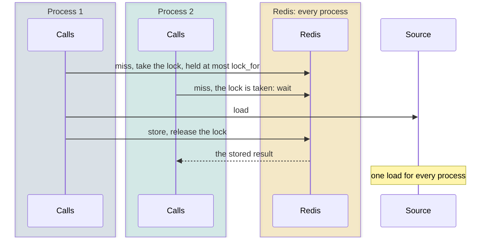
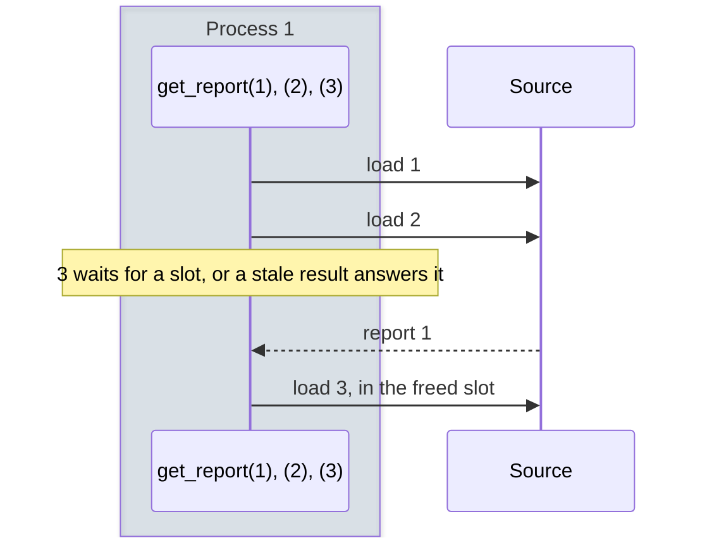

# Stampede protection

When a popular key expires, every caller misses at the same moment, and they all ask the source.
That's a stampede. [`Stampede`][pashe.options.Stampede], from `pashe.options`, keeps your source
from getting all those calls at once. You can:

- [share a load](#sharing-a-load-within-a-process) inside a process;
- [lock it](#locking-a-load-across-processes) across processes;
- [limit how many loads](#limiting-loads-at-once) run at once;
- [reload a key](#reload-before-the-ttl) before its TTL ends;
- [spread out when entries expire](#spreading-out-when-entries-expire) if they were stored together.

A [batch](caching/batches.md) takes `jitter` and `max_loads`, but it refuses `lock_for` and
`revalidate_before`. Why? A batch waits for its own load and never loads in the background.

Some options work in the memory of one process. Others hold a lock in the backend, so they cover
every process that uses it: see [Where each feature works](choosing.md#where-each-feature-works).

## Sharing a load within a process

When several calls in one process miss the same key at the same time, they share one load. The
first call loads, and the others wait for it and get its result. This is on by default. Set
[`share_loads`][pashe.options.Stampede(share_loads)] to `False` to turn it off.

=== "Sync"

    ```python hl_lines="14 19"
    --8<-- "stampedes/share_loads_sync.py:show"
    ```

=== "Async"

    ```python hl_lines="14 19"
    --8<-- "stampedes/share_loads_async.py:show"
    ```



!!! warning "Callers that wait together get one object"

    Everyone who waited for the same load gets the same object. Copy a result before you change
    it. If your callers change what the function returns, turn `share_loads` off for it.

## Locking a load across processes

`share_loads` still leaves one load per process. With ten processes, that's ten loads. Take a
lock in the backend with [`lock_for`][pashe.options.Stampede(lock_for)], and you're down to one
load for all of them.

=== "Sync"

    ```python hl_lines="14"
    --8<-- "stampedes/lock_for_sync.py:show"
    ```

=== "Async"

    ```python hl_lines="14"
    --8<-- "stampedes/lock_for_async.py:show"
    ```



`lock_for` is the longest time the lock is held. If a process dies while it holds the lock, the
lock frees itself after that time. Set it higher than your slowest load.

## Limiting loads at once

Some sources can only handle so many requests at once. [`max_loads`][pashe.options.Stampede(max_loads)]
limits how many loads one function runs at the same time in one process, whatever their keys.

=== "Sync"

    ```python hl_lines="14"
    --8<-- "stampedes/max_loads_sync.py:show"
    ```

=== "Async"

    ```python hl_lines="14"
    --8<-- "stampedes/max_loads_async.py:show"
    ```



A call over `max_loads` waits for a free slot. If there's a stale result for it, the call returns
that result right away instead, and your hooks get an `OverloadedError`.

## Reload before the TTL

Even a key you read all the time expires, and the calls right after that miss or get a stale
result. With [`revalidate_before`][pashe.options.Stampede(revalidate_before)], pashe reloads the
result while it's still fresh. Here, calls in its last 10 seconds get it right away, as a HIT, and
one caller reloads it in the background.

=== "Sync"

    ```python hl_lines="14"
    --8<-- "stampedes/revalidate_before_sync.py:show"
    ```

=== "Async"

    ```python hl_lines="14"
    --8<-- "stampedes/revalidate_before_async.py:show"
    ```

<div class="pashe-timeline">
<div class="pashe-timeline__fresh" style="flex: 50" data-start="0"><b>HIT</b><br>fresh</div>
<div class="pashe-timeline__fresh" style="flex: 10" data-start="50 s"><b>HIT</b><br>at once, a reload in the background</div>
<div class="pashe-timeline__fresh" style="flex: 60" data-start="60 s"><b>HIT</b><br>the reloaded result, fresh for 60 s more</div>
</div>

The reload holds a lock in the backend, so only one process reloads a key at a time. If a reload
fails, the error goes to `on_error`. The old result is still returned until its TTL ends, and
after that `Stale` decides.

If nobody reads the key in those last seconds, it expires as usual. Compare this with
`Stale(while_revalidate=...)`: here no call ever gets a result past its TTL. The price is a load a
little more often.

## Spreading out when entries expire

Entries stored together, say after a deploy or a cold start, also expire together. Then your
source gets all their loads at once. [`jitter`][pashe.options.Stampede(jitter)] gives each entry a
TTL of its own, a little shorter or longer. It applies to the TTL of `Negative` too.

=== "Sync"

    ```python hl_lines="14"
    --8<-- "stampedes/jitter_sync.py:show"
    ```

=== "Async"

    ```python hl_lines="14"
    --8<-- "stampedes/jitter_async.py:show"
    ```

<div class="pashe-timeline">
<div class="pashe-timeline__fresh" style="flex: 54" data-start="0"><b>HIT</b><br>every entry is fresh</div>
<div class="pashe-timeline__stale" style="flex: 12" data-start="54 s"><b>MISS</b><br>one entry after another expires</div>
<div class="pashe-timeline__source" data-start="66 s"><b>every entry</b><br>has expired</div>
</div>

With `jitter=0.1` and `ttl=60`, an entry lives between 54 and 66 seconds. Entries stored together
now reload over 12 seconds instead of all in the same moment.
