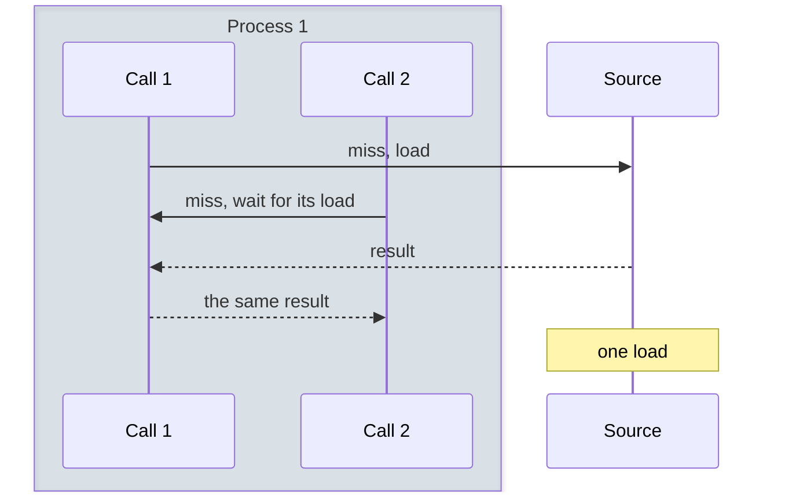
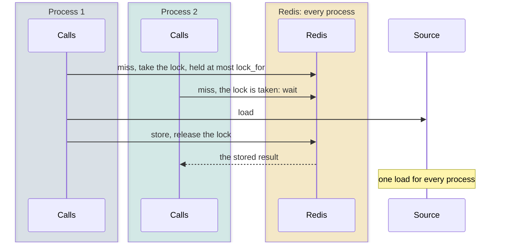
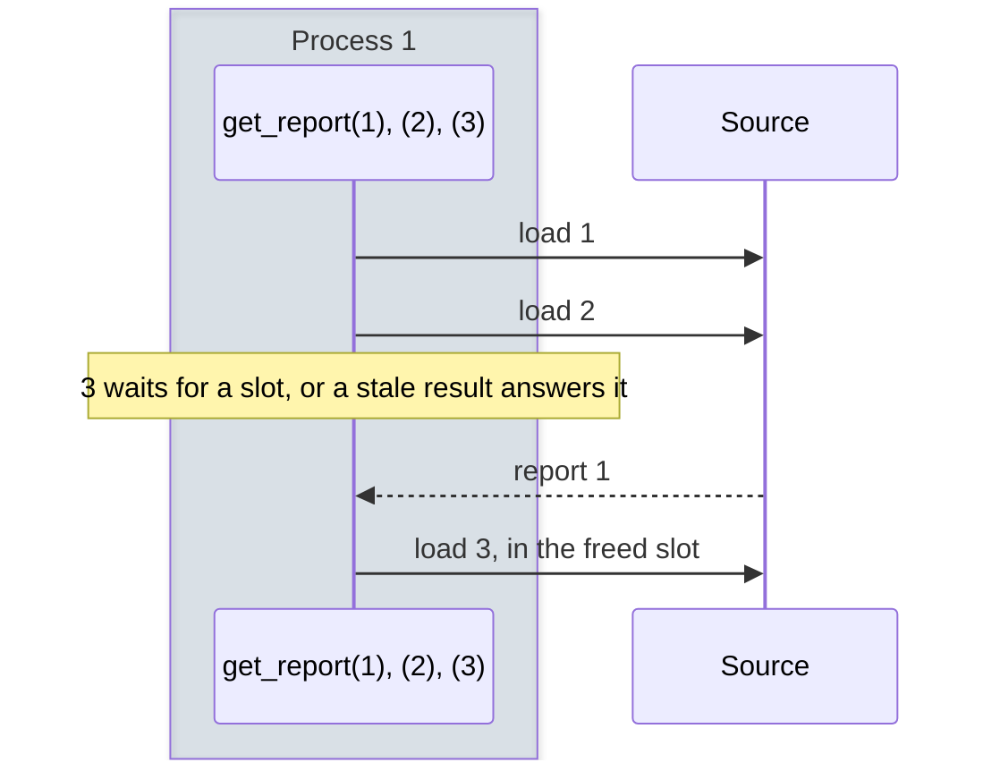

# Stampede protection

When a popular key expires, every caller misses at once and asks the source: a stampede. The
options of [`Stampede`][pashe.options.Stampede], from `pashe.options`, keep the source from being
asked by every caller at once: they [share a load](#sharing-a-load-within-a-process) in a process,
[lock it](#locking-a-load-across-processes) across processes,
[limit the loads](#limiting-loads-at-once) at once, [reload a key](#reload-before-the-ttl) before
its TTL and [spread the expiry](#spreading-the-expiry) of entries stored together.

A [batch](caching/batches.md) takes `jitter` and `max_loads`, and refuses `lock_for` and
`revalidate_before`: it waits for its load and loads nothing in the background.

The options of a process work in its memory; those of the backend hold a lock in it, so they
reach every process over it: [Where each feature works](choosing.md#where-each-feature-works).

## Sharing a load within a process

Calls of one key at the same time in one process share one load: the first loads, the others wait
for it and get its result. It is on by default; [`share_loads`][pashe.options.Stampede(share_loads)]
set to `False` turns it off.

=== "Sync"

    ```python hl_lines="14 19"
    --8<-- "stampedes/share_loads_sync.py:show"
    ```

=== "Async"

    ```python hl_lines="14 19"
    --8<-- "stampedes/share_loads_async.py:show"
    ```



!!! warning "Concurrent callers share one object"

    The callers of one load get the same object: copy a result before you change it, or turn
    `share_loads` off for a function whose callers change what it returns.

## Locking a load across processes

`share_loads` leaves one load per process; with ten processes that is ten loads. A load lock in
the backend, [`lock_for`][pashe.options.Stampede(lock_for)], leaves one for all of them.

=== "Sync"

    ```python hl_lines="14"
    --8<-- "stampedes/lock_for_sync.py:show"
    ```

=== "Async"

    ```python hl_lines="14"
    --8<-- "stampedes/lock_for_async.py:show"
    ```



`lock_for` is the longest the lock is held, so a process that dies holding it frees it: give it
more than the slowest load takes.

## Limiting loads at once

[`max_loads`][pashe.options.Stampede(max_loads)] limits the loads of one function in one process,
whatever their keys, for a source that takes only so many at once.

=== "Sync"

    ```python hl_lines="14"
    --8<-- "stampedes/max_loads_sync.py:show"
    ```

=== "Async"

    ```python hl_lines="14"
    --8<-- "stampedes/max_loads_async.py:show"
    ```



A call over `max_loads` waits for a slot; when a stale result can answer it, that result answers
at once instead, and the hooks hear an `OverloadedError`.

## Reload before the TTL

A key read all the time still expires, and the calls right after it miss or answer stale. With
[`revalidate_before`][pashe.options.Stampede(revalidate_before)] the result is reloaded while it is
still fresh: here, the calls of its last 10 seconds get it at once, a HIT, and one caller reloads it
in the background.

=== "Sync"

    ```python hl_lines="14"
    --8<-- "stampedes/revalidate_before_sync.py:show"
    ```

=== "Async"

    ```python hl_lines="14"
    --8<-- "stampedes/revalidate_before_async.py:show"
    ```

<div class="pashe-timeline">
<div class="pashe-timeline__fresh" style="flex: 50" data-start="0"><b>HIT</b><br>fresh</div>
<div class="pashe-timeline__fresh" style="flex: 10" data-start="50 s"><b>HIT</b><br>at once, a reload in the background</div>
<div class="pashe-timeline__fresh" style="flex: 60" data-start="60 s"><b>HIT</b><br>the reloaded result, fresh for 60 s more</div>
</div>

The reload holds a lock in the backend, so one process reloads a key at a time; a failed reload
goes to `on_error`, and the result answers until its TTL, then as `Stale` says. A key nobody
reads in those seconds expires as without it. Unlike `Stale(while_revalidate=...)`, no call
gets a result past its TTL; the price is a load a little more often.

## Spreading the expiry

Entries stored together, as after a deploy or a cold start, expire together, and the source gets all
their loads at once. [`jitter`][pashe.options.Stampede(jitter)] gives each entry a TTL of its own, a
little shorter or longer, the TTL of `Negative` too.

=== "Sync"

    ```python hl_lines="14"
    --8<-- "stampedes/jitter_sync.py:show"
    ```

=== "Async"

    ```python hl_lines="14"
    --8<-- "stampedes/jitter_async.py:show"
    ```

<div class="pashe-timeline">
<div class="pashe-timeline__fresh" style="flex: 54" data-start="0"><b>HIT</b><br>every entry is fresh</div>
<div class="pashe-timeline__stale" style="flex: 12" data-start="54 s"><b>MISS</b><br>one entry after another expires</div>
<div class="pashe-timeline__source" data-start="66 s"><b>every entry</b><br>has expired</div>
</div>

With `jitter=0.1` and `ttl=60` an entry lives from 54 to 66 seconds, so the loads of entries
stored together come over 12 seconds instead of in the same moment.
