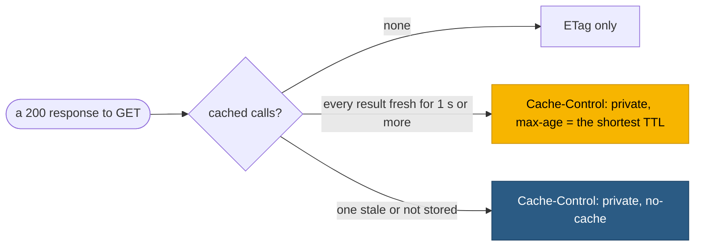

# HTTP caching headers

[`CacheHeadersMiddleware`][pashe.asgi.CacheHeadersMiddleware] adds caching headers to every
successful `GET` response. Use the one from `pashe.wsgi` for a sync app and the one from
`pashe.asgi` for an async one. It adds:

- an `ETag` of the body, so the client can get a `304`;
- when the endpoint made cached calls, `Cache-Control` from their shortest TTL, and
  `Cache-Status` as RFC 9211 describes.

=== "Sync"

    ```python hl_lines="9 10 24"
    --8<-- "web/wsgi_sync.py:show"
    ```

=== "Async"

    ```python hl_lines="8 9 11"
    --8<-- "web/headers_fastapi.py:show"
    ```

## What a client sees

Here's how the FastAPI service from the Async tab answers: one endpoint with one cached function
behind it. The first request runs `get_product`. It's a miss, fresh for its 60-second TTL, minus
the time the request took.

```console hl_lines="5 6 7"
$ curl -i http://localhost:8000/products/1
HTTP/1.1 200 OK
content-length: 24
content-type: application/json
etag: "a761cd8c95a5db71c678ea1e5c290d8a"
cache-control: private, max-age=59
cache-status: pashe; fwd=miss; ttl=59

{"id":1,"name":"Kettle"}
```

The next one is answered from the cache. Same body, so same `ETag`.

```console hl_lines="7"
$ curl -i http://localhost:8000/products/1
HTTP/1.1 200 OK
content-length: 24
content-type: application/json
etag: "a761cd8c95a5db71c678ea1e5c290d8a"
cache-control: private, max-age=59
cache-status: pashe; hit; ttl=59

{"id":1,"name":"Kettle"}
```

A client that kept the response sends its `ETag`, and gets a `304` without the body.

```console hl_lines="2"
$ curl -i http://localhost:8000/products/1 -H 'If-None-Match: "a761cd8c95a5db71c678ea1e5c290d8a"'
HTTP/1.1 304 Not Modified
etag: "a761cd8c95a5db71c678ea1e5c290d8a"
cache-control: private, max-age=59
cache-status: pashe; hit; ttl=59
```

The ASGI server adds its own headers, such as `date` and `server`. They're left out here.

When the endpoint sets no `Cache-Control`, the middleware picks one like this:



How does the middleware know about a request's cached calls? Through a
[`CacheHeadersHook`][pashe.hooks.CacheHeadersHook] from `pashe.hooks`. Give the same hook to every
cache your app calls and to the middleware. Your endpoint code doesn't change.

Calls to a cache without the hook are left out of `Cache-Control` and `Cache-Status`. `ETag` and
`304` work either way. The ETag is a hash of the response, not of a cached value, so it's correct
whatever else the response holds.

!!! warning "Responses are private by default"

    The default [`cache_control`][pashe.asgi.CacheHeadersMiddleware(cache_control)], `"private"`,
    lets only the client keep a response, since cached data may belong to one user. Set
    `cache_control="public"` only when responses are the same for everyone. Then shared caches
    and proxies keep them too.

## A request that asks for fresh data

A browser on a hard reload, or `curl -H 'Cache-Control: no-cache'`, asks to skip every stored
response. So does HTTP/1.0's `Pragma: no-cache`.

The middleware lets such a request through to the source only if
[`honor_no_cache`][pashe.asgi.CacheHeadersMiddleware(honor_no_cache)] allows it. Then its cached
calls load, store what they loaded for the next requests, and answer with
`Cache-Status: pashe; fwd=request`. Any other request with the header is answered from the cache,
as if the header weren't there.

```python hl_lines="16 17 20"
--8<-- "web/no_cache_fastapi.py:show"
```

```console hl_lines="3 6"
$ curl -si http://localhost:8000/products/1 -H 'Cache-Control: no-cache' | grep cache-status
cache-status: pashe; hit; ttl=59
$ curl -si http://localhost:8000/products/1 -H 'Cache-Control: no-cache' -H 'X-Role: staff' | grep cache-status
cache-status: pashe; fwd=request; ttl=60
```

`Cache-Control: max-age=0`, which a browser sends on a plain reload, doesn't count. In code,
`with` [`pashe.no_cache()`][pashe.no_cache] does the same for every cached call in the block.

!!! warning "Any client can send the header"

    Every allowed request loads from the source, so an allowed client could skip the cache
    whenever it wants. By default no one is allowed. Allow only those you trust, such as staff
    behind your login.

!!! note "A 304 still runs the endpoint"

    The ETag is a hash of the body, so the endpoint has to run to compute it. A `304` only saves
    the transfer. A streamed response passes through as it is, and so does a WSGI response without
    `Content-Length`.
